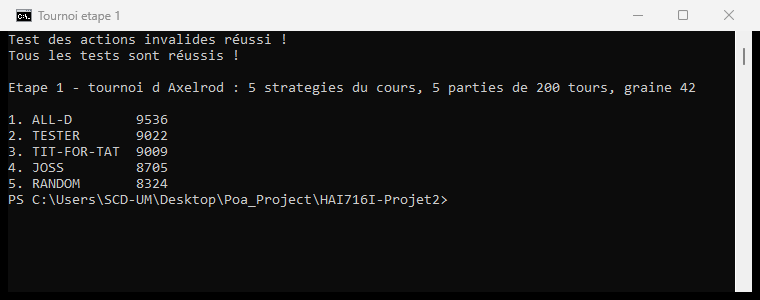

# Journal de bord — Abdellah DORBANE

HAI716I, Projet 2 (partie 1) : tournoi de dilemme du prisonnier itéré.
Binôme : Skander SAAFI. Code commun, un journal chacun. Langage : Python.

---

## 1. Protocole

Ce tableau est complété au fur et à mesure du projet.

| Paramètre | Valeur | Raison |
|---|---|---|
| Gains | CC = 3/3, CD = 0/5, DC = 5/0, DD = 2/2 | matrice du cours |
| Tours par partie | 200 | format d'Axelrod |
| Parties par paire | 5 | format d'Axelrod |
| Graine | fixée dans le moteur (42) | résultats rejouables à l'identique |
| Match contre soi-même | non (choix du moteur) | Axelrod l'incluait : effet discuté en partie 4 |
| Population de l'étape 1 | ALL-D, RANDOM, TIT-FOR-TAT, TESTER, JOSS | imposée par l'énoncé |
| Ma nouvelle stratégie (étape 2) | GRUDGER | voir partie 5 |

---

## 2. Le point de départ (13/11)

Le sujet part du tournoi d'Axelrod vu au cours 4 : chaque stratégie affronte toutes les autres, 5 parties de 200 tours, et le meilleur score total gagne. En 1980, c'est TIT-FOR-TAT, la stratégie la plus simple, qui l'a emporté. Notre travail : reconstruire ce tournoi, voir si on retrouve ce résultat, puis le modifier.

Avec Skander, nous nous sommes réparti le travail : lui construit le moteur et le tournoi, moi j'écris les stratégies. Chacun travaille sur sa branche Git.

Pour que nos deux parties s'emboîtent, nous nous sommes d'abord mis d'accord sur une seule chose : la façon dont le moteur appelle une stratégie. Chaque stratégie a un nom et une méthode `jouer(mes_coups, ses_coups, rng)` qui renvoie C ou D. Le `rng`, c'est le hasard fourni par le moteur avec une graine fixe : c'est ce qui permet de relancer le tournoi et d'obtenir exactement le même résultat, comme le demande l'énoncé.

À partir de là, j'ai écrit les stratégies une par une, avec un commit pour chacune.

---

## 3. Étape 1 — Les cinq stratégies du cours (13/11)

### 3.1. ALL-D, la trahison systématique

J'ai commencé par la plus simple : ALL-D joue toujours D. Le cours la présente comme la stratégie « rationnelle » : au dernier tour, trahir rapporte plus ; donc à l'avant-dernier aussi ; et en remontant ainsi, on trahit dès le premier tour.

Sur le papier, elle devrait écraser RANDOM, qui coopère une fois sur deux sans jamais se venger : chaque C de RANDOM lui rapporte 5 points. Mais face à TIT-FOR-TAT, elle ne gagne que le premier tour : ensuite les deux jouent D et ALL-D tombe à 2 points par tour, alors que deux stratégies qui coopèrent en gagnent 3.

**Mon avis :** ALL-D gagne tous ses duels ou fait match nul, mais je pense que ce n'est pas suffisant pour gagner un tournoi. Ce qui compte, c'est le total des points, et ALL-D se prive des 3 points par tour de la coopération. Elle ne peut finir en tête que si la population contient beaucoup de stratégies faciles à exploiter.

### 3.2. RANDOM, le témoin

RANDOM joue C ou D à pile ou face. Elle ne cherche pas à gagner : elle sert de référence. Une stratégie qui fait moins bien que le hasard a clairement un problème.

Elle n'a pas d'adversaire favorable particulier, et elle devrait souffrir face à ALL-D, qui profite de chacun de ses C.

**Mon avis :** comme elle ne réagit à rien, elle ne peut ni punir ni être récompensée. Je m'attends à la voir en bas du classement.

### 3.3. TIT-FOR-TAT, la gagnante de 1980

TIT-FOR-TAT commence par C, puis recopie le dernier coup de l'adversaire. Gentille au départ, elle punit une trahison au tour suivant, et pardonne dès que l'adversaire revient à C.

Contre les stratégies gentilles, et contre elle-même, elle coopère tout le temps : 3 points par tour. En revanche, elle ne gagne jamais un duel : contre ALL-D, elle perd le premier tour et ne rattrape jamais. Toute sa force vient de l'ensemble des rencontres, pas d'un duel en particulier. Contre JOSS, je m'attends à des représailles en écho (voir 3.5).

**Mon avis :** sa force, c'est d'être lisible : l'adversaire comprend vite qu'une trahison sera punie et qu'une coopération sera rendue. Son point faible, c'est qu'elle ne sait pas sortir d'une série de représailles : une seule trahison peut la faire alterner D/C pendant longtemps. Dans une petite population comme la nôtre, avec peu de stratégies gentilles, je ne suis pas sûr qu'elle gagne.

### 3.4. TESTER, celle qui m'a obligé à trancher

Le cours la décrit en une phrase : « D au premier tour. Si l'adversaire riposte, joue TIT-FOR-TAT ; sinon répète C, C, D. » Au moment de la coder, cette phrase ne suffisait plus. Deux questions se posaient.

**Qu'est-ce qu'une riposte ?** J'ai choisi : l'adversaire joue D au tour juste après un D de TESTER, que ce soit le D d'ouverture ou un D du cycle.

**Une fois en TIT-FOR-TAT, est-ce que TESTER peut redevenir « testeur » ?** J'ai choisi que non : le passage est définitif. La stratégie retient qu'il y a eu riposte jusqu'à la fin de la partie. Il faut donc qu'elle reparte de zéro à chaque nouvelle partie, ce que fait le moteur de Skander.

Pour être sûr de mon code, j'ai déroulé trois parties à la main :

| Adversaire | TESTER joue | Ce qui se passe |
|---|---|---|
| toujours C | D C C D C C D C C | aucune riposte → cycle C, C, D |
| TIT-FOR-TAT | D C D C D C D C | TFT riposte au tour 2 → TESTER copie TFT |
| ALL-D | D C D D D | riposte, puis TFT contre ALL-D |

Le deuxième cas montre un problème. Contre TIT-FOR-TAT, les deux stratégies restent décalées d'un tour et ne reviennent jamais à C/C : elles alternent pendant toute la partie. Le D d'ouverture de TESTER lui coûte donc cher face à une stratégie qui punit. Elle devrait en revanche bien profiter des stratégies qui ne se vengent jamais, en les trahissant un tour sur trois.

**Mon avis :** l'idée de « tester » l'adversaire est maline, mais elle a un coût : avec ma règle, toute stratégie qui punit la fait entrer dans une alternance qui ne s'arrête jamais. Je pense qu'elle sera pénalisée dès que la population contient des stratégies qui se vengent.

### 3.5. JOSS, la trahison sournoise

JOSS se comporte comme TIT-FOR-TAT, mais une fois sur dix, au lieu de coopérer, elle trahit. Dans le code, je calcule d'abord ce que TIT-FOR-TAT jouerait ; si c'est C, je tire au hasard pour savoir si JOSS le remplace par D.

Ces trahisons surprises devraient lui rapporter quelques points contre les stratégies naïves. Mais contre TIT-FOR-TAT, ou contre elle-même, l'enchaînement est prévisible : JOSS trahit, l'adversaire riposte, JOSS recopie la riposte, et les deux alternent D/C, C/D jusqu'à la trahison suivante. C'est le même phénomène que le bruit présenté en cours, sauf qu'ici il est volontaire.

**Mon avis :** JOSS essaie de gagner un peu plus que TIT-FOR-TAT en trichant de temps en temps. Je pense que c'est un mauvais calcul : chaque trahison de 5 points se paie ensuite par plusieurs tours de représailles. Elle illustre bien la règle d'Axelrod « ne pas être trop malin ».

---

## 4. Étape 1 — Le premier tournoi (15/11)

Une fois mes stratégies fusionnées avec le moteur de Skander sur la branche `main`, nous avons pu lancer le vrai tournoi : les cinq stratégies du cours, 5 parties de 200 tours par paire, graine 42.

### 4.1. TIT-FOR-TAT ne gagne pas

C'est ALL-D qui gagne, et TIT-FOR-TAT ne finit que troisième. Le résultat de 1980 n'est donc pas reproduit. Pour comprendre pourquoi, j'ai regardé le score de TIT-FOR-TAT contre chaque adversaire (total sur les 5 parties) :

| TIT-FOR-TAT contre | Score de TFT | Ce qui se passe |
|---|---|---|
| ALL-D | 1990 | elle perd le premier tour, puis D/D jusqu'à la fin |
| RANDOM | 2494 | ni exploitée, ni récompensée |
| TESTER | 2500 | l'alternance D/C prévue en 3.4 |
| JOSS | 2021 | les représailles en écho prévues en 3.5 |

TIT-FOR-TAT n'atteint jamais 3000 points, c'est-à-dire 3 points par tour : dans cette population, **aucun adversaire ne coopère vraiment avec elle**. TESTER la teste, JOSS triche, RANDOM joue au hasard. Or sa force vient justement de la coopération avec les autres stratégies gentilles.

ALL-D, de son côté, a une proie : contre RANDOM, elle marque 3494 points, son meilleur score. C'est ce qui la fait passer devant tout le monde.

### 4.2. Pourquoi notre résultat diffère de celui de 1980

Je vois deux différences avec le tournoi d'Axelrod :

1. **La taille et la nature de la population.** En 1980, il y avait 14 programmes, et la plupart commençaient par coopérer. TIT-FOR-TAT trouvait donc beaucoup de partenaires avec qui gagner 3 points par tour. Ici, avec cinq stratégies dont aucune n'est vraiment gentille à part elle, elle n'en a aucun.
2. **Les matchs contre soi-même.** Axelrod faisait jouer chaque programme contre son jumeau ; notre moteur ne le fait pas. J'ai mesuré ces matchs avec le même moteur : TIT-FOR-TAT contre elle-même marque 3000 points, ALL-D contre elle-même seulement 2000. En les ajoutant, TIT-FOR-TAT repasse en tête (environ 12 000 points contre 11 700 pour TESTER et 11 500 pour ALL-D).

Ce résultat rejoint ce que dit le cours : TIT-FOR-TAT n'est pas « la » stratégie optimale, elle prospère seulement s'il y a assez de stratégies qui pensent comme elle.

### 4.3. Ce que je retiens par rapport à mes avis

- ALL-D gagne, mais uniquement grâce à une proie facile (RANDOM) : c'est ce que j'avais envisagé en 3.1.
- RANDOM finit dernière, comme prévu en 3.2.
- Les deux comportements que j'avais repérés en déroulant les parties à la main se retrouvent dans les scores : l'alternance TESTER/TIT-FOR-TAT (2500 de chaque côté) et l'écho JOSS/TIT-FOR-TAT.
- Une surprise : TESTER finit deuxième, devant TIT-FOR-TAT. Son D d'ouverture lui coûte contre TIT-FOR-TAT, mais elle exploite RANDOM et JOSS un peu mieux que TIT-FOR-TAT.

---

## 5. Étape 2 — Ma nouvelle stratégie : GRUDGER

Pour l'étape 2, il fallait une stratégie absente du cours. Je l'ai écrite le 13/11, juste après les cinq stratégies du cours. J'ai hésité entre PAVLOV, TIT-FOR-TWO-TATS, TIT-FOR-TAT généreux et GRUDGER. J'ai choisi **GRUDGER**, « le rancunier ».

Sa règle : je coopère tant que tu n'as jamais trahi ; à ta première trahison, je joue D jusqu'à la fin. Elle vient de James Friedman, qui l'avait soumise au tournoi d'Axelrod ; on la connaît aussi sous le nom de *Grim Trigger*.

Ce qui m'a décidé, c'est qu'elle est l'exact opposé d'une des règles qu'Axelrod tire de son tournoi : « pardonner ». GRUDGER ne pardonne jamais. Elle permet donc de poser une vraie question : si elle finit bien classée, le pardon compte peu dans notre population ; si elle s'effondre, cela confirme Axelrod.

Je m'attends à ce qu'elle joue très bien contre les stratégies gentilles, avec qui elle coopère jusqu'au bout, et correctement contre ALL-D, où elle ne perd que le premier tour, comme TIT-FOR-TAT. En revanche, contre TESTER et JOSS, une seule trahison suffit à la faire basculer en D pour toujours, là où TIT-FOR-TAT aurait pardonné.

---

## 6. Impasses

- **La règle de TESTER ne suffisait pas.** Au départ, je pensais coder TESTER directement à partir de la phrase du cours. En réalité, elle ne dit pas ce qu'est une riposte ni si le passage en TIT-FOR-TAT est définitif. J'ai dû faire deux choix, expliqués en 3.4. En déroulant les parties à la main, j'ai vu qu'avec ces choix, TESTER contre TIT-FOR-TAT ne revient jamais à la coopération. Une autre interprétation aurait pu donner un comportement très différent.
