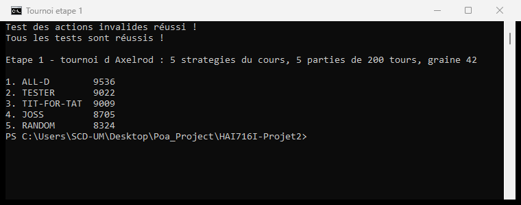
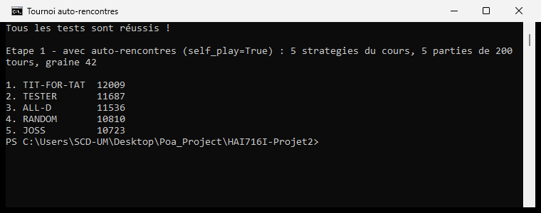
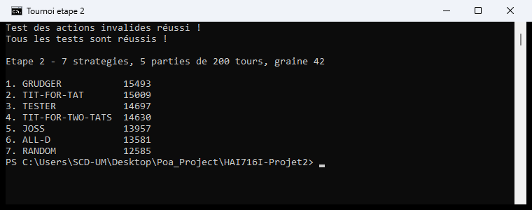
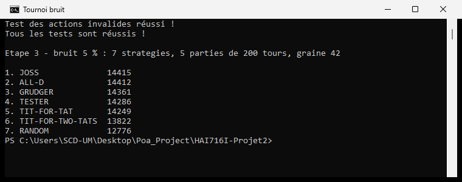
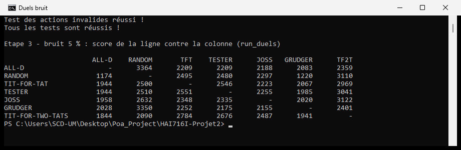
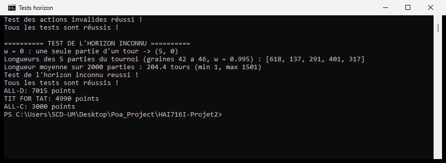
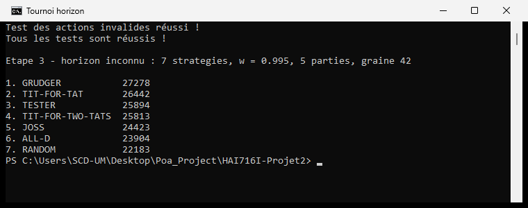
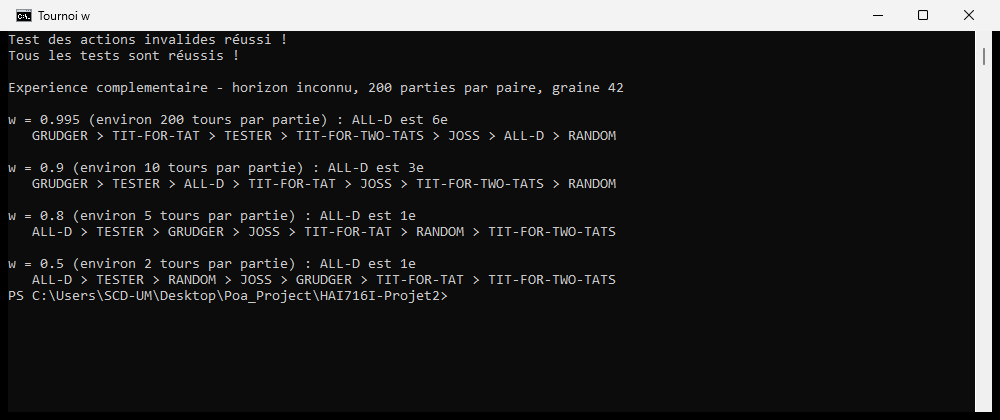

# Journal de bord — Abdellah DORBANE

HAI716I, Projet 2 (partie 1) : tournoi de dilemme du prisonnier itéré.
Binôme : Skander SAAFI. Code commun, un journal chacun. Langage : Python.

---

## 1. Protocole

Ce tableau est complété au fur et à mesure du projet.

| Paramètre | Valeur | Raison |
|---|---|---|
| Gains | CC = 3/3, CD = 0/5, DC = 5/0, DD = 2/2 | matrice du cours |
| Tours par partie | 200 | format d'Axelrod |
| Parties par paire | 5 | format d'Axelrod |
| Graine | fixée dans le moteur (42) | résultats rejouables à l'identique |
| Match contre soi-même | non par défaut, option `self_play` dans le moteur | Axelrod l'incluait : effet mesuré en partie 4 |
| Population de l'étape 1 | ALL-D, RANDOM, TIT-FOR-TAT, TESTER, JOSS | imposée par l'énoncé |
| Ma nouvelle stratégie (étape 2) | GRUDGER | voir partie 5 |
| Stratégie de Skander (étape 2) | TIT-FOR-TWO-TATS | voir partie 5 |
| Modifications (étape 3) | bruit 5 % ; horizon inconnu, w = 0,995 | voir partie 6 |

---

## 2. Le point de départ (13/11)

Le sujet part du tournoi d'Axelrod vu au cours 4 : chaque stratégie affronte toutes les autres, 5 parties de 200 tours, et le meilleur score total gagne. En 1980, c'est TIT-FOR-TAT, la stratégie la plus simple, qui l'a emporté. Notre travail : reconstruire ce tournoi, voir si on retrouve ce résultat, puis le modifier.

Avec Skander, nous nous sommes réparti le travail : lui construit le moteur et le tournoi, moi j'écris les stratégies. Chacun travaille sur sa branche Git.

Pour que nos deux parties s'emboîtent, nous nous sommes d'abord mis d'accord sur une seule chose : la façon dont le moteur appelle une stratégie. Chaque stratégie a un nom et une méthode `jouer(mes_coups, ses_coups, rng)` qui renvoie C ou D. Le `rng`, c'est le hasard fourni par le moteur avec une graine fixe : c'est ce qui permet de relancer le tournoi et d'obtenir exactement le même résultat, comme le demande l'énoncé.

À partir de là, j'ai écrit les stratégies une par une, avec un commit pour chacune. Restait à savoir si notre version du tournoi allait donner le même vainqueur qu'en 1980.

---

## 3. Étape 1 — Les cinq stratégies du cours (13/11)

### 3.1. ALL-D, la trahison systématique

J'ai commencé par la plus simple : ALL-D joue toujours D. Le cours la présente comme la stratégie « rationnelle » : au dernier tour, trahir rapporte plus ; donc à l'avant-dernier aussi ; et en remontant ainsi, on trahit dès le premier tour.

Sur le papier, elle devrait écraser RANDOM, qui coopère une fois sur deux sans jamais se venger : chaque C de RANDOM lui rapporte 5 points. Mais face à TIT-FOR-TAT, elle ne gagne que le premier tour : ensuite les deux jouent D et ALL-D tombe à 2 points par tour, alors que deux stratégies qui coopèrent en gagnent 3.

**Mon avis :** ALL-D gagne tous ses duels ou fait match nul, mais je pense que ce n'est pas suffisant pour gagner un tournoi. Ce qui compte, c'est le total des points, et ALL-D se prive des 3 points par tour de la coopération. Elle ne peut finir en tête que si la population contient beaucoup de stratégies faciles à exploiter.

### 3.2. RANDOM, le témoin

RANDOM joue C ou D à pile ou face. Elle ne cherche pas à gagner : elle sert de référence. Une stratégie qui fait moins bien que le hasard a clairement un problème.

Elle n'a pas d'adversaire favorable particulier, et elle devrait souffrir face à ALL-D, qui profite de chacun de ses C.

**Mon avis :** comme elle ne réagit à rien, elle ne peut ni punir ni être récompensée. Je m'attends à la voir en bas du classement.

### 3.3. TIT-FOR-TAT, la gagnante de 1980

TIT-FOR-TAT commence par C, puis recopie le dernier coup de l'adversaire. Gentille au départ, elle punit une trahison au tour suivant, et pardonne dès que l'adversaire revient à C.

Contre les stratégies gentilles, et contre elle-même, elle coopère tout le temps : 3 points par tour. En revanche, elle ne gagne jamais un duel : contre ALL-D, elle perd le premier tour et ne rattrape jamais. Toute sa force vient de l'ensemble des rencontres, pas d'un duel en particulier. Contre JOSS, je m'attends à des représailles en écho (voir 3.5).

**Mon avis :** sa force, c'est d'être lisible : l'adversaire comprend vite qu'une trahison sera punie et qu'une coopération sera rendue. Son point faible, c'est qu'elle ne sait pas sortir d'une série de représailles : une seule trahison peut la faire alterner D/C pendant longtemps. Dans une petite population comme la nôtre, avec peu de stratégies gentilles, je ne suis pas sûr qu'elle gagne.

### 3.4. TESTER, celle qui m'a obligé à trancher

Le cours la décrit en une phrase : « D au premier tour. Si l'adversaire riposte, joue TIT-FOR-TAT ; sinon répète C, C, D. » Au moment de la coder, cette phrase ne suffisait plus. Deux questions se posaient.

**Qu'est-ce qu'une riposte ?** J'ai choisi : l'adversaire joue D au tour juste après un D de TESTER, que ce soit le D d'ouverture ou un D du cycle.

**Une fois en TIT-FOR-TAT, est-ce que TESTER peut redevenir « testeur » ?** J'ai choisi que non : le passage est définitif. La stratégie retient qu'il y a eu riposte jusqu'à la fin de la partie. Il faut donc qu'elle reparte de zéro à chaque nouvelle partie, ce que fait le moteur de Skander.

Pour être sûr de mon code, j'ai déroulé trois parties à la main :

| Adversaire | TESTER joue | Ce qui se passe |
|---|---|---|
| toujours C | D C C D C C D C C | aucune riposte → cycle C, C, D |
| TIT-FOR-TAT | D C D C D C D C | TFT riposte au tour 2 → TESTER copie TFT |
| ALL-D | D C D D D | riposte, puis TFT contre ALL-D |

Le deuxième cas montre un problème. Contre TIT-FOR-TAT, les deux stratégies restent décalées d'un tour et ne reviennent jamais à C/C : elles alternent pendant toute la partie. Le D d'ouverture de TESTER lui coûte donc cher face à une stratégie qui punit. Elle devrait en revanche bien profiter des stratégies qui ne se vengent jamais, en les trahissant un tour sur trois.

**Mon avis :** l'idée de « tester » l'adversaire est maline, mais elle a un coût : avec ma règle, toute stratégie qui punit la fait entrer dans une alternance qui ne s'arrête jamais. Je pense qu'elle sera pénalisée dès que la population contient des stratégies qui se vengent.

### 3.5. JOSS, la trahison sournoise

JOSS se comporte comme TIT-FOR-TAT, mais une fois sur dix, au lieu de coopérer, elle trahit. Dans le code, je calcule d'abord ce que TIT-FOR-TAT jouerait ; si c'est C, je tire au hasard pour savoir si JOSS le remplace par D.

Ces trahisons surprises devraient lui rapporter quelques points contre les stratégies naïves. Mais contre TIT-FOR-TAT, ou contre elle-même, l'enchaînement est prévisible : JOSS trahit, l'adversaire riposte, JOSS recopie la riposte, et les deux alternent D/C, C/D jusqu'à la trahison suivante. C'est le même phénomène que le bruit présenté en cours, sauf qu'ici il est volontaire.

**Mon avis :** JOSS essaie de gagner un peu plus que TIT-FOR-TAT en trichant de temps en temps. Je pense que c'est un mauvais calcul : chaque trahison de 5 points se paie ensuite par plusieurs tours de représailles. Elle illustre bien la règle d'Axelrod « ne pas être trop malin ».

Mes cinq stratégies étaient écrites et mes avis notés. Il ne restait plus qu'à les faire s'affronter pour de vrai.

---

## 4. Étape 1 — Le premier tournoi (15/11)

Une fois mes stratégies fusionnées avec le moteur de Skander sur la branche `main`, nous avons pu lancer le vrai tournoi : les cinq stratégies du cours, 5 parties de 200 tours par paire, graine 42.

### 4.1. TIT-FOR-TAT ne gagne pas

C'est ALL-D qui gagne, et TIT-FOR-TAT ne finit que troisième. Le résultat de 1980 n'est donc pas reproduit. Pour comprendre pourquoi, j'ai regardé le score de TIT-FOR-TAT contre chaque adversaire (total sur les 5 parties, obtenu avec la fonction `run_duels`) :

| TIT-FOR-TAT contre | Score de TFT | Ce qui se passe |
|---|---|---|
| ALL-D | 1990 | elle perd le premier tour, puis D/D jusqu'à la fin |
| RANDOM | 2498 | ni exploitée, ni récompensée |
| TESTER | 2500 | l'alternance D/C prévue en 3.4 |
| JOSS | 2021 | les représailles en écho prévues en 3.5 |

TIT-FOR-TAT n'atteint jamais 3000 points, c'est-à-dire 3 points par tour : dans cette population, **aucun adversaire ne coopère vraiment avec elle**. TESTER la teste, JOSS triche, RANDOM joue au hasard. Or sa force vient justement de la coopération avec les autres stratégies gentilles.

ALL-D, de son côté, a une proie : contre RANDOM, elle marque 3494 points, son meilleur score. C'est ce qui la fait passer devant tout le monde.

### 4.2. Pourquoi notre résultat diffère de celui de 1980

Je vois deux différences avec le tournoi d'Axelrod :

1. **La taille et la nature de la population.** En 1980, il y avait 14 programmes, et beaucoup commençaient par coopérer. TIT-FOR-TAT trouvait donc beaucoup de partenaires avec qui gagner 3 points par tour. Ici, avec cinq stratégies dont aucune n'est vraiment gentille à part elle, elle n'en a aucun.
2. **Les matchs contre soi-même.** Axelrod faisait jouer chaque programme contre son jumeau ; notre tournoi de référence ne le fait pas. Pour vérifier si cela suffisait à expliquer l'écart, Skander a ajouté au moteur une option `self_play`, et j'ai relancé le même tournoi avec ces matchs :

TIT-FOR-TAT repasse en tête avec 12 009 points, devant TESTER (11 687) et ALL-D (11 536). L'explication tient en deux chiffres : contre elle-même, TIT-FOR-TAT coopère pendant toute la partie et marque 3000 points sur les 5 parties ; ALL-D contre elle-même ne marque que 2000 points. Ces 1000 points d'écart suffisent à inverser le classement.

Ce résultat rejoint ce que dit le cours : TIT-FOR-TAT n'est pas « la » stratégie optimale, elle prospère seulement s'il y a assez de stratégies qui pensent comme elle.

### 4.3. Ce que je retiens par rapport à mes avis

- ALL-D gagne, mais uniquement grâce à une proie facile (RANDOM) : c'est ce que j'avais envisagé en 3.1.
- RANDOM finit dernière, comme prévu en 3.2.
- Les deux comportements que j'avais repérés en déroulant les parties à la main se retrouvent dans les scores : l'alternance TESTER/TIT-FOR-TAT (2500 de chaque côté) et l'écho JOSS/TIT-FOR-TAT.
- Une surprise : TESTER finit deuxième, devant TIT-FOR-TAT. Son D d'ouverture lui coûte contre TIT-FOR-TAT, mais elle exploite RANDOM et JOSS un peu mieux que TIT-FOR-TAT.

Une question restait ouverte : si TIT-FOR-TAT perd parce qu'elle n'a pas de partenaires, que se passe-t-il quand on en ajoute ? C'est exactement ce que l'étape 2 allait permettre de voir.

---

## 5. Étape 2 — De nouvelles stratégies

### 5.1. Ma stratégie : GRUDGER

Pour l'étape 2, il fallait une stratégie absente du cours. Je l'ai écrite le 13/11, juste après les cinq stratégies du cours. J'ai hésité entre PAVLOV, TIT-FOR-TWO-TATS, TIT-FOR-TAT généreux et GRUDGER. J'ai choisi **GRUDGER**, « le rancunier ».

Sa règle : je coopère tant que tu n'as jamais trahi ; à ta première trahison, je joue D jusqu'à la fin. Elle vient de James Friedman, qui l'avait soumise au tournoi d'Axelrod ; on la connaît aussi sous le nom de *Grim Trigger*.

Ce qui m'a décidé, c'est qu'elle est l'exact opposé d'une des règles qu'Axelrod tire de son tournoi : « pardonner ». GRUDGER ne pardonne jamais. Elle permet donc de poser une vraie question : si elle finit bien classée, le pardon compte peu dans notre population ; si elle s'effondre, cela confirme Axelrod.

Je m'attends à ce qu'elle joue très bien contre les stratégies gentilles, avec qui elle coopère jusqu'au bout, et correctement contre ALL-D, où elle ne perd que le premier tour, comme TIT-FOR-TAT. En revanche, contre TESTER et JOSS, une seule trahison suffit à la faire basculer en D pour toujours, là où TIT-FOR-TAT aurait pardonné.

### 5.2. La stratégie de Skander : TIT-FOR-TWO-TATS

De son côté, Skander a choisi **TIT-FOR-TWO-TATS**, « donnant-donnant à deux coups ».

Sa règle : je coopère, et je ne trahis que si l'adversaire a joué D **deux fois de suite**. Une trahison isolée est donc laissée passer. C'est une version plus patiente de TIT-FOR-TAT. Elle vient elle aussi des tournois d'Axelrod : après le premier tournoi, Axelrod avait remarqué qu'elle aurait pu le gagner si quelqu'un l'avait proposée, et John Maynard Smith l'a soumise au second tournoi.

En mettant nos deux stratégies côte à côte, je me suis rendu compte qu'elles étaient presque opposées : la mienne ne pardonne jamais, la sienne pardonne facilement. Ça tombait bien pour voir lequel des deux comportements s'en sort le mieux.

D'après sa règle, elle devrait bien jouer contre les stratégies gentilles, comme TIT-FOR-TAT, et surtout mieux que TIT-FOR-TAT contre JOSS : quand JOSS trahit par surprise, TIT-FOR-TWO-TATS ne riposte pas, donc il n'y a pas d'écho de représailles et la coopération reprend tout de suite. Par contre, contre ALL-D, elle perd les deux premiers tours au lieu d'un seul, et une stratégie qui trahit souvent mais jamais deux fois de suite pourrait l'exploiter sans jamais être punie.

**Mon avis :** sa patience est un avantage quand les trahisons sont rares et accidentelles, mais c'est aussi une porte ouverte pour les stratégies qui calculent leurs trahisons.

### 5.3. Le tournoi à sept stratégies (15/11)

On a relancé le tournoi avec les sept stratégies, en gardant exactement le même protocole qu'à l'étape 1.

Je ne m'attendais pas à ça : **GRUDGER finit première**. TIT-FOR-TAT remonte à la deuxième place, et ALL-D, qui avait gagné l'étape 1, tombe à la sixième.

Pour comprendre pourquoi ma stratégie gagne, j'ai affiché le score de chaque duel avec la fonction `run_duels` :

Voici ce que ça donne pour GRUDGER (ligne GRUDGER de la capture) :

| GRUDGER contre | Score de GRUDGER | Ce qui se passe |
|---|---|---|
| TIT-FOR-TAT, TIT-FOR-TWO-TATS | 3000 | elles coopèrent du début à la fin |
| RANDOM | 3480 | RANDOM trahit vite, GRUDGER passe en D pour toujours et en profite |
| ALL-D | 1990 | elle perd seulement le premier tour |
| TESTER | 2005 | le D du premier tour de TESTER la fait basculer |
| JOSS | 2018 | la première trahison de JOSS suffit |

En fait, GRUDGER fait un peu les deux à la fois : avec les stratégies gentilles, elle coopère comme TIT-FOR-TAT, et contre RANDOM, elle trahit tout le temps comme ALL-D (3480 points, alors que TIT-FOR-TAT n'en fait que 2498). Ses deux points faibles, TESTER et JOSS, sont bien ceux que j'avais prévus en 5.1, mais ils ne lui font pas perdre assez de points pour la faire descendre.

### 5.4. Ce qui a changé par rapport à l'étape 1

**Les nouvelles stratégies ne donnent rien à ALL-D.** ALL-D exploite toujours RANDOM (3494 points), mais les deux nouvelles stratégies commencent par coopérer et se défendent : ALL-D ne fait qu'environ 2000 points contre chacune. Par contre, entre elles, les stratégies gentilles se font 3000 points. C'est justement ce qui manquait à TIT-FOR-TAT à l'étape 1 : maintenant elle a des partenaires, et elle repasse devant ALL-D. Ça rejoint ce que je pensais en partie 4 : TIT-FOR-TAT a besoin d'autres stratégies qui coopèrent pour bien marcher.

**TESTER profite de TIT-FOR-TWO-TATS.** En regardant les duels, j'ai vu que TESTER fait 3670 points contre elle, son meilleur score. En déroulant la partie, j'ai compris pourquoi : le cycle de TESTER, C, C, D, ne contient jamais deux D de suite. Du coup, TIT-FOR-TWO-TATS ne riposte jamais et se fait avoir pendant toute la partie. Être patient, ça coûte cher contre quelqu'un qui trahit souvent mais jamais deux fois d'affilée.

**Mais la patience paie contre JOSS.** Comme le laissait penser sa règle (5.2), TIT-FOR-TWO-TATS fait 2629 points contre JOSS, alors que TIT-FOR-TAT n'en fait que 2046 : quand JOSS trahit par surprise, elle ne riposte pas, et la coopération reprend sans écho de représailles. Sa patience l'aide contre les trahisons rares, et la dessert contre les trahisons régulières.

**Le pardon ne gagne pas ici.** J'avais choisi GRUDGER pour tester la règle « pardonner » d'Axelrod, et dans notre tournoi, c'est la stratégie rancunière qui gagne, alors que la plus patiente finit quatrième. Mon explication : comme il n'y a aucune erreur, les stratégies gentilles ne trahissent jamais, donc GRUDGER n'a jamais besoin de pardonner. Je pense que ça changera si un coup peut être inversé par erreur : une seule erreur et GRUDGER trahit jusqu'à la fin. C'est ce que l'étape 3 allait vérifier.

Avec les auto-rencontres, le haut du classement ne change pas : GRUDGER (18 493) reste devant TIT-FOR-TAT (18 009).

---

## 6. Étape 3 — Modifier le tournoi

Pour l'étape 3, il fallait appliquer au moins deux modifications au tournoi. Avec Skander, on a choisi le **bruit** et l'**horizon inconnu**. Pour le code, on s'est réparti le travail : Skander programme le bruit, moi l'horizon inconnu. Mais chacun fait ses propres prédictions et sa propre analyse pour les deux.

Pour chaque modification, j'ai écrit ma prédiction ici avant de lancer quoi que ce soit.

### 6.1. Le bruit

Avec le bruit, chaque coup peut être inversé par erreur avec une petite probabilité (5 %, l'exemple de l'énoncé) : une stratégie veut jouer C, mais c'est D qui part, ou l'inverse.

On l'a choisi parce que le cours en parle (deux TIT-FOR-TAT qui se punissent en écho après une seule erreur), et surtout parce que c'est le vrai test pour ma stratégie : à l'étape 2, GRUDGER a gagné parce que personne ne trahissait par erreur.

**Ma prédiction (écrite avant de lancer le tournoi) :**

Avec des erreurs, GRUDGER perdra sa première place : une seule erreur suffit à la rendre rancunière pour toute la partie, même contre les stratégies gentilles. C'est TIT-FOR-TWO-TATS qui gagnera, car elle laisse passer une trahison isolée.

**Implémentation**

C'est Skander qui a codé le bruit dans le moteur : un paramètre `noise`, et à chaque tour, chaque coup est inversé avec cette probabilité. Le coup inversé est celui qui est vraiment joué : il compte dans les gains et l'adversaire le voit dans l'historique. Le bruit a son propre générateur aléatoire, donc il ne change ni les coups de RANDOM et JOSS ni la longueur des parties.

**Résultats**

Le classement change complètement par rapport à l'étape 2. JOSS passe de la cinquième à la première place, ALL-D de la sixième à la deuxième, et GRUDGER tombe à la troisième place. TIT-FOR-TWO-TATS finit sixième.

En regardant les scores, j'ai remarqué que les trois premiers sont très proches : 54 points d'écart sur environ 14 400. J'ai donc relancé le tournoi avec dix autres graines (0 à 9) pour savoir si ce classement était solide : JOSS est première 9 fois sur 10, GRUDGER est deuxième 9 fois sur 10, et TIT-FOR-TWO-TATS est sixième les 10 fois. Avec la graine 42, ALL-D passe juste devant GRUDGER, mais c'est l'exception.

**Comparaison avec ma prédiction**

Ma prédiction était à moitié juste.

- **GRUDGER perd bien sa première place**, mais elle ne s'effondre pas : elle reste dans les trois premières.
- **TIT-FOR-TWO-TATS ne gagne pas du tout**, elle finit avant-dernière. C'est la partie fausse de ma prédiction.

Pour comprendre, j'ai regardé les duels avec bruit :

**Pourquoi GRUDGER recule.** Contre TIT-FOR-TAT et TIT-FOR-TWO-TATS, elle faisait 3000 points sans bruit ; maintenant elle n'en fait plus que 2252 et 2401. C'est exactement ce que j'avais prévu : une seule erreur, et elle trahit jusqu'à la fin de la partie, même contre une stratégie gentille.

**Pourquoi elle reste quand même devant.** Ce que je n'avais pas prévu, c'est que GRUDGER garde ses points contre RANDOM (3350) et reste la meilleure contre ALL-D (2028). Le bruit lui fait perdre ses partenaires, mais elle continue d'exploiter les stratégies qui trahissent.

**Pourquoi TIT-FOR-TWO-TATS ne gagne pas.** C'est là que je me suis trompé. Je pensais que sa patience la protégerait des erreurs. Mais les duels montrent deux problèmes :

1. **Contre GRUDGER, elle tombe de 3000 à 1941 points.** Sa patience ne sert à rien si l'autre ne pardonne pas : quand c'est elle qui fait une erreur, GRUDGER la punit pour toujours. Pardonner ne suffit pas, il faut que les deux pardonnent.
2. **Contre ALL-D, elle fait 1844 points, son pire score.** De temps en temps, un D d'ALL-D est inversé en C par erreur. Ça casse la série de « deux D de suite » que TIT-FOR-TWO-TATS attend pour riposter, donc elle recommence à coopérer et se fait exploiter encore.

**Pourquoi JOSS monte.** Contre TIT-FOR-TAT, JOSS gagne 302 points de plus qu'à l'étape 2. Je n'ai pas de preuve directe de la raison, seulement une explication possible : sans bruit, une trahison de JOSS lançait un écho de représailles D/C, C/D qui pouvait durer longtemps, et avec le bruit, une nouvelle erreur peut casser cet écho et ramener la coopération, comme le montre le cours. Pour le vérifier vraiment, il faudrait regarder les historiques des parties coup par coup, ce que je n'ai pas fait.

**Ce que j'en retiens**

Avec le bruit, la coopération est beaucoup plus fragile : les stratégies gentilles perdent les points qu'elles se donnaient entre elles, et l'écart avec les stratégies qui trahissent devient minuscule. J'avais raison sur le fait que ne jamais pardonner coûte cher quand des erreurs sont possibles. Mais je me suis trompé sur la solution : pardonner les trahisons isolées ne suffit pas, il faut aussi que l'adversaire pardonne, et ne pas se laisser exploiter. Le cours propose justement une autre idée, TIT-FOR-TAT généreux, qui pardonne de temps en temps au hasard. Ce serait intéressant de la tester.

Le bruit attaquait la coopération par les erreurs. Ma deuxième modification, elle, s'attaque à l'argument principal d'ALL-D : le dernier tour.

### 6.2. L'horizon inconnu

Au lieu de jouer exactement 200 tours, après chaque tour la partie continue avec une probabilité w. Personne ne sait donc quand elle va s'arrêter.

J'ai choisi cette modification parce qu'elle touche directement l'argument du cours en faveur d'ALL-D : la récurrence à rebours ne marche que si on connaît le dernier tour. Le cours dit aussi que l'infini n'est pas nécessaire pour coopérer, il suffit que les joueurs sachent qu'ils ont de bonnes chances de se revoir. Je voulais voir ce que ça change concrètement dans notre tournoi.

Pour pouvoir comparer avec l'étape 2, j'ai choisi **w = 0,995** : une partie dure alors 200 tours en moyenne (1 / (1 − w) = 200), comme avant. La seule différence, c'est que certaines parties seront plus courtes et d'autres plus longues.

**Ma prédiction (écrite avant de lancer le tournoi) :**

Je pense que l'horizon inconnu va aider ALL-D. Les stratégies jouent pareil qu'avant, mais avec w, certaines parties vont être très courtes. Et dans une partie courte, le premier tour compte beaucoup : ALL-D le gagne contre les gentilles (5 points pour elle, 0 pour l'autre), et après il n'y a pas assez de tours pour que TIT-FOR-TAT ou GRUDGER rattrapent en coopérant. Sur 200 tours, perdre le premier tour ce n'est presque rien, mais sur 10 tours ça fait une vraie différence.

Du coup, je m'attends à ce qu'ALL-D remonte beaucoup par rapport à l'étape 2 (elle était sixième) et qu'elle passe devant les stratégies gentilles.

**Implémentation et test**

J'ai ajouté au moteur un paramètre `continuation` (c'est w). Après chaque tour, on tire un nombre au hasard : s'il dépasse w, la partie s'arrête. Sans ce paramètre, le moteur joue toujours exactement 200 tours, donc les étapes 1 et 2 ne changent pas.

J'ai fait un choix : ce tirage utilise son propre générateur, qui dépend seulement de la graine de la partie. Du coup, la partie n°1 a la même longueur pour toutes les paires, la partie n°2 aussi, etc. Je l'ai fait exprès : sinon, une stratégie pourrait gagner juste parce qu'elle est tombée sur des parties plus longues, et la comparaison ne serait plus juste.

Pour vérifier, j'ai écrit un test : avec w = 0, une partie dure bien un seul tour ; la longueur est la même quelles que soient les stratégies ; et sur 2000 parties avec w = 0,995, la moyenne est de 204 tours, avec des parties d'un seul tour et d'autres de plus de 1500 tours.

**Résultats**

Le classement est **exactement le même qu'à l'étape 2** : GRUDGER reste première et ALL-D reste sixième. Les scores sont plus élevés, mais c'est seulement parce que les parties ont été plus longues : 1764 tours au total sur les 5 parties, au lieu de 1000.

**Comparaison avec ma prédiction**

Ma prédiction était fausse : ALL-D n'a pas remonté du tout. En cherchant pourquoi, j'ai regardé la longueur des 5 parties : 618, 137, 291, 401 et 317 tours (elles s'affichent dans la capture du test). Grâce au générateur réservé à l'arrêt des parties, ce sont les mêmes 5 longueurs pour toutes les paires de stratégies. Il n'y a eu **aucune partie courte**. Or mon raisonnement reposait justement sur les parties courtes. Sur 137 tours ou plus, le premier tour gagné par ALL-D (5 points contre 0) ne pèse presque rien face aux 3 points par tour que les stratégies gentilles se donnent entre elles.

J'ai relancé avec d'autres graines (0, 100, 1000) : le classement ne bouge pas. Ce n'est donc pas un hasard de la graine 42. Avec w = 0,995, les parties très courtes sont rares, et nos stratégies jouent exactement pareil quelle que soit la longueur, puisqu'aucune ne regarde le numéro du tour.

**Expérience complémentaire : à partir de quand ALL-D gagne-t-elle ?**

Je voulais savoir si mon idée était fausse, ou si les parties n'étaient juste pas assez courtes. J'ai donc relancé le tournoi avec des w plus petits. Comme les longueurs varient beaucoup d'une partie à l'autre, j'ai pris **200 parties par paire** au lieu de 5 pour que le hasard des longueurs s'équilibre. Cette expérience sort donc du protocole de référence, elle sert seulement à tester mon raisonnement.

| w | Longueur moyenne | Rang d'ALL-D |
|---|---|---|
| 0,995 | environ 200 tours | 6e |
| 0,9 | environ 10 tours | 3e |
| 0,8 | environ 5 tours | 1re |
| 0,5 | environ 2 tours | 1re |

Mon idée n'était donc pas complètement fausse : quand les parties sont vraiment courtes, le premier tour pèse beaucoup et ALL-D finit par gagner. Mais il faut des parties d'environ 5 tours en moyenne, très loin des 200 tours de notre protocole.

**Ce que j'en retiens**

Je me suis trompé sur l'ordre de grandeur, pas sur le mécanisme. Ça rejoint le cours : pour que la coopération l'emporte, il n'est pas nécessaire que le jeu soit infini, il suffit que « le futur pèse assez lourd », c'est-à-dire que les joueurs aient de bonnes chances de se revoir. Avec w = 0,995, c'est largement le cas ; avec w = 0,8, ce n'est plus le cas, et dans notre population de sept stratégies, c'est ALL-D qui obtient le meilleur score. Ça ne veut pas dire que trahir est la meilleure stratégie dans l'absolu : avec d'autres adversaires, le résultat pourrait être différent.

Au bout de ces deux expériences, deux de mes trois prédictions étaient fausses. C'est pourtant en revenant dessus que j'ai le plus appris.

---

## 7. Impasses

Ce sont les moments où mon raisonnement n'a pas marché, et ce que j'ai changé ensuite.

- **TIT-FOR-TAT ne gagne pas à l'étape 1.** En lisant le cours, je pensais retrouver le résultat d'Axelrod. En écrivant TIT-FOR-TAT, j'ai commencé à en douter (3.3), et le tournoi l'a confirmé : c'est ALL-D qui a gagné. En regardant les duels, j'ai compris que le problème venait de la population : TIT-FOR-TAT n'avait aucun partenaire gentil. J'ai arrêté de voir TIT-FOR-TAT comme « la meilleure stratégie » et j'ai commencé à regarder contre qui chaque stratégie joue (partie 4).
- **La règle de TESTER ne suffisait pas.** Je pensais pouvoir la coder directement à partir de la phrase du cours, mais elle ne dit pas ce qu'est une riposte. J'ai dû faire un choix, et en déroulant les parties à la main, j'ai vu que ce choix changeait complètement son comportement contre TIT-FOR-TAT (partie 3.4).
- **Ma prédiction sur l'horizon inconnu était fausse.** Je pensais qu'ALL-D allait remonter grâce aux parties courtes, mais le classement n'a pas bougé. Au lieu d'abandonner l'idée, j'ai cherché si elle était fausse ou juste mal dimensionnée : en diminuant w, j'ai vu qu'ALL-D gagne bien, mais seulement avec des parties d'environ 5 tours (partie 6.2).
- **Ma prédiction sur TIT-FOR-TWO-TATS avec le bruit était fausse.** Je pensais que sa patience la protégerait des erreurs, et elle a fini avant-dernière. Ça m'a fait changer d'avis sur le pardon : pardonner ne sert à rien si l'adversaire ne pardonne pas, ou s'il en profite (partie 6.1).

---

## 8. Bilan

### 8.1. Ce que j'ai appris sur la coopération

En lisant le cours, je pensais au début que TIT-FOR-TAT allait simplement gagner, comme en 1980. Les trois étapes m'ont montré que ce n'est pas aussi simple : le classement dépend surtout de **qui joue contre qui** et **des règles du tournoi**.

| Étape | Gagnant | Ce que ça m'a appris |
|---|---|---|
| Étape 1 : 5 stratégies du cours | ALL-D | sans partenaires gentils, la coopération ne rapporte rien ; avec les auto-rencontres, TIT-FOR-TAT repasse devant |
| Étape 2 : 7 stratégies | GRUDGER | dès qu'il y a assez de stratégies gentilles, la coopération gagne, et ALL-D tombe à la sixième place |
| Étape 3 : horizon inconnu (w = 0,995) | GRUDGER | le classement ne bouge pas tant que les parties restent longues ; ALL-D ne gagne qu'avec des parties d'environ 5 tours |
| Étape 3 : bruit 5 % | JOSS | les erreurs cassent la coopération entre gentilles, et les écarts entre stratégies deviennent minuscules |

Pour moi, l'idée la plus importante, c'est que la coopération a besoin de deux choses : **des partenaires qui coopèrent aussi**, et **un futur assez long** pour que trahir ne rapporte pas. Quand une de ces deux conditions manque (peu de stratégies gentilles à l'étape 1, parties très courtes avec un petit w), c'est ALL-D qui s'en sort le mieux.

### 8.2. Ce que j'ai retenu de ma stratégie

J'avais choisi GRUDGER pour tester la règle « pardonner » d'Axelrod. Le résultat est plus nuancé que ce que je pensais :
- **sans erreurs**, ne jamais pardonner ne coûte presque rien : GRUDGER gagne l'étape 2 et l'horizon inconnu ;
- **avec des erreurs**, elle perd ses partenaires, mais elle reste dans les trois premières parce qu'elle continue d'exploiter les stratégies qui trahissent.

Et la stratégie de Skander m'a montré l'autre côté : pardonner tout seul ne suffit pas non plus, si l'adversaire ne pardonne pas ou s'il en profite.

### 8.3. Mes prédictions

| Prédiction | Résultat |
|---|---|
| Bruit : GRUDGER perd sa première place | juste |
| Bruit : TIT-FOR-TWO-TATS gagne | faux, elle finit sixième |
| Horizon inconnu : ALL-D remonte et passe devant les gentilles | faux avec w = 0,995, juste seulement avec des parties d'environ 5 tours |

Je me suis trompé deux fois sur trois. Mais à chaque fois, chercher pourquoi m'a appris plus que les prédictions justes : c'est en regardant les duels que j'ai compris que la patience de TIT-FOR-TWO-TATS se retourne contre elle, et c'est en changeant w que j'ai vu à partir de quand le premier tour compte vraiment.

### 8.4. Limites et améliorations possibles

En relisant tout le travail, je vois plusieurs limites à nos résultats :

- **Une petite population.** Nous n'avons que sept stratégies, alors qu'Axelrod en avait quatorze. Comme on l'a vu à chaque étape, ajouter ou retirer une seule stratégie peut changer le gagnant.
- **Peu de parties.** Le protocole de référence ne fait que 5 parties par paire. Avec le hasard (RANDOM, JOSS, le bruit, la longueur des parties), certains écarts sont très petits : avec le bruit, les trois premières ne sont séparées que de 54 points. J'ai vérifié avec d'autres graines, mais une seule graine de référence reste une limite.
- **Des choix d'interprétation.** La règle de TESTER dans le cours n'est pas complète : avec une autre définition de la « riposte », ses résultats, et ceux de ses adversaires, pourraient changer.
- **Une seule valeur pour chaque modification.** Le bruit n'a été testé qu'à 5 %, et l'horizon inconnu surtout avec w = 0,995. L'expérience complémentaire sur w montre que la valeur choisie change complètement la conclusion ; ce serait sûrement pareil pour le bruit.

Si j'avais plus de temps, j'essaierais :
- **TIT-FOR-TAT généreux**, présenté dans le cours : une stratégie qui pardonne de temps en temps au hasard, pour voir si elle résiste mieux au bruit que GRUDGER et TIT-FOR-TWO-TATS ;
- **plusieurs niveaux de bruit** (1 %, 5 %, 10 %) pour voir à partir de quand GRUDGER s'effondre vraiment ;
- **la sélection sur plusieurs générations**, l'une des modifications proposées par l'énoncé, pour voir quelles stratégies survivent quand la population évolue selon les scores ;
- **combiner le bruit et l'horizon inconnu**, pour se rapprocher d'une situation réelle où on fait des erreurs et où on ne sait pas quand on se reverra.

