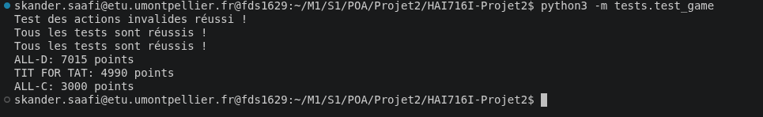

# Journal de bord — Projet 2 : Dilemme du prisonnier itéré

**Étudiant :** Skander SAAFI  
**UE :** HAI716I — Programmation Orientée Agents  
**Langage :** Python

## 1. Organisation du travail

Nous avons réparti le développement en deux branches Git pour travailler en parallèle :

- **Ma partie (`feature/engine`) :** moteur du jeu et tournoi.
- **Mon binôme (`feature/strategies`) :** implémentation des stratégies de base.

Les deux parties seront ensuite intégrées pour réaliser les expériences.

## 2. Tournoi de base

### 2.1. Implémentation

J'ai développé le moteur permettant de simuler une partie du dilemme du prisonnier itéré, avec la matrice de gains imposée et 200 tours par défaut.

J'ai fait plusieurs choix techniques :
- Deux historiques distincts, mis à jour après les deux décisions pour garantir leur simultanéité.
- Des graines pseudo-aléatoires fixes pour rendre les résultats reproductibles.
- Une interface commune `jouer(mes_coups, ses_coups, rng)` pour intégrer facilement les stratégies.

J'ai ensuite implémenté le tournoi tous contre tous : chaque paire de stratégies joue 5 parties de 200 tours. Les scores sont cumulés pour établir le classement final.

Dans cette première version, les paires inversées et les auto-rencontres sont exclues.

### 2.2. Tests et difficultés

J'ai validé le moteur avec trois stratégies simples : ALL-C, ALL-D et TIT-FOR-TAT. Les tests de la matrice des gains et des scores ont réussi, et le tournoi s'exécute correctement.

*Capture d'écran des tests réussis : *

### 2.3. Résultats et analyse des cinq stratégies

## 3. Ajout de nouvelles stratégies

## 4. Modifications du tournoi et expérimentations

## 5. Bilan final

