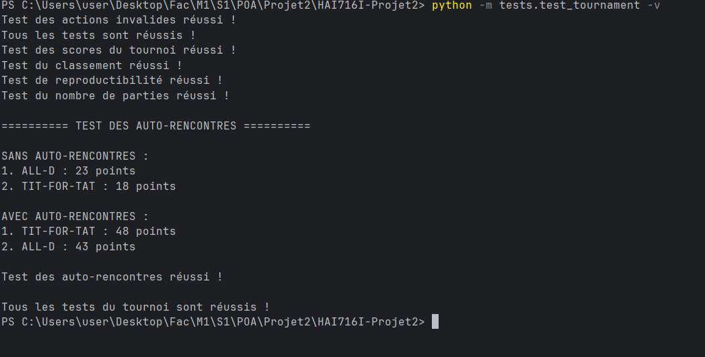

# Journal de bord — Projet 2 : Dilemme du prisonnier itéré

**Étudiant :** Skander SAAFI  
**UE :** HAI716I - Programmation Orientée Agents  
**Langage :** Python
**Période :** 13–15 novembre 2026

## Partie 1 - Présentation du projet
### 1.1. Introduction
Ce projet consiste à développer un tournoi de dilemme du prisonnier itéré, inspiré des travaux de Robert Axelrod, afin d'étudier les interactions entre différentes stratégies.

L'objectif est de comparer les cinq stratégies étudiées en cours, d'en introduire de nouvelles, puis d'observer comment des modifications du tournoi influencent leurs performances.

Une attention particulière sera portée aux conditions favorisant la coopération, aux réactions face aux défections et aux différences entre les résultats obtenus et ceux du tournoi historique d'Axelrod.

### 1.2. Protocole expérimental
Le tournoi repose sur le dilemme du prisonnier itéré. À chaque tour, deux joueurs choisissent simultanément de coopérer (C) ou de faire défection (D), sans connaître le choix courant de leur adversaire.

Les gains sont définis par la matrice suivante :

| | Adversaire C | Adversaire D |
|---|---|---|
| **Joueur C** | (3, 3) | (0, 5) |
| **Joueur D** | (5, 0) | (2, 2) |

Le protocole initial comprend :

- **Population :** ALL-D, RANDOM, TIT-FOR-TAT, TESTER et JOSS.
- **Durée :** 200 tours par partie.
- **Répétitions :** 5 parties par paire de stratégies.
- **Graine pseudo-aléatoire :** 42, incrémentée selon le numéro de la partie.
- **Classement :** cumul des points obtenus par chaque stratégie.

Ces paramètres reprennent le cadre du tournoi demandé. La graine fixe permet de reproduire les expériences, notamment lorsque les stratégies utilisent des décisions aléatoires.

Dans notre première implémentation, chaque paire de stratégies distinctes joue cinq parties, sans confrontation d'une stratégie contre elle-même. Nous évitons également de répéter les confrontations inversées. Ces deux choix sont distincts et peuvent influencer le classement final.

Les expériences suivantes conserveront ce protocole de référence, sauf pour les paramètres explicitement modifiés, afin de faciliter les comparaisons.

### 1.3. Organisation du travail

Le développement a été réparti sur deux branches Git pour travailler en parallèle :

- **Ma partie (`feature/engine`) :** développement du moteur du jeu, du tournoi et des tests automatiques.
- **Partie de mon binôme (`feature/strategies_base`) :** implémentation des stratégies.

Nous avons défini une interface commune `jouer(mes_coups, ses_coups, rng)` afin de faciliter l'intégration des deux parties.

Les modifications sont enregistrées par des commits Git pour conserver une trace du développement.

## Partie 2 — Développement et expérimentations

### 2.1. Étape 1 — Tournoi de base

#### 2.1.1. Hypothèses initiales
Avant d'analyser les résultats du tournoi initial, je m'attendais à ce que TIT-FOR-TAT obtienne un bon classement, notamment grâce à sa capacité à coopérer avec les stratégies coopératives tout en sanctionnant les défections. Son comportement simple et réciproque avait notamment permis d'obtenir de bons résultats dans les tournois historiques d'Axelrod.

Je pensais également que ALL-D serait performante face aux stratégies qui coopèrent fréquemment, puisqu'elle peut exploiter leur coopération. En revanche, face à des stratégies capables de riposter, ses gains risquaient d'être limités.

Concernant RANDOM, je m'attendais à des résultats irréguliers, car ses décisions ne tiennent pas compte du comportement de l'adversaire.

Enfin, je supposais que TESTER et JOSS pourraient profiter de certaines stratégies coopératives, mais que leurs défections risquaient également de provoquer des représailles et de réduire leurs scores à long terme.

Mon hypothèse principale était donc que TIT-FOR-TAT figurerait parmi les stratégies les mieux classées, sans nécessairement terminer première, puisque le résultat dépend aussi des adversaires présents et du protocole du tournoi.

#### 2.1.2. Implémentation
J'ai commencé par développer le moteur d'une partie, puis le système permettant d'organiser un tournoi entre plusieurs stratégies.

Trois choix techniques ont guidé mon implémentation :

- **Simultanéité des décisions :** chaque stratégie dispose de son propre historique et de celui de son adversaire. Les historiques sont mis à jour uniquement après les deux décisions, afin qu'aucun joueur ne puisse connaître le coup courant de l'autre.
- **Reproductibilité :** les décisions aléatoires reposent sur des générateurs initialisés avec des graines déterminées, permettant de relancer les expériences dans les mêmes conditions.
- **Extensibilité :** toutes les stratégies utilisent l'interface `jouer(mes_coups, ses_coups, rng)`, ce qui permet d'en ajouter sans modifier le fonctionnement général du moteur.

J'ai ensuite implémenté le tournoi tous contre tous. Chaque paire de stratégies distinctes joue cinq parties de 200 tours, et les scores sont cumulés pour établir un classement décroissant.

Cette séparation entre moteur, tournoi et stratégies facilite les tests et permettra d'introduire les modifications expérimentales sans reconstruire l'ensemble du programme.

Pour le tournoi initial, nous avons utilisé les cinq stratégies étudiées en cours. Le tableau suivant résume leurs règles, leurs origines et leurs comportements attendus face aux autres stratégies.

| Stratégie | Origine | Règle de fonctionnement | Forces et faiblesses attendues |
|---|---|---|---|
| **ALL-D** | Stratégie de référence étudiée en cours. | Joue toujours D, quel que soit le comportement adverse. | Exploite les stratégies coopératives, mais obtient des gains limités face aux adversaires qui ripostent systématiquement. |
| **RANDOM** | Stratégie aléatoire de référence étudiée en cours. | Choisit C ou D aléatoirement à chaque tour. | Imprévisible, mais incapable d'adapter ses décisions à l'historique adverse. |
| **TIT-FOR-TAT** | Stratégie présentée par Anatol Rapoport lors des tournois d'Axelrod. | Commence par C, puis reproduit le dernier coup de l'adversaire. | Favorise la coopération réciproque et sanctionne rapidement les défections, mais peut être entraînée dans des cycles de représailles. |
| **TESTER** | Stratégie étudiée en cours, issue des stratégies exploratoires du dilemme du prisonnier itéré. | Commence par tester l'adversaire avec une défection. Selon sa réaction, elle poursuit une exploitation périodique ou adopte un comportement de type TIT-FOR-TAT. | Peut exploiter les adversaires tolérants, mais risque de déclencher des représailles durables. |
| **JOSS** | Variante historique de TIT-FOR-TAT étudiée en cours. | Suit TIT-FOR-TAT, mais effectue occasionnellement une défection lorsque la coopération était prévue (probabilité de 10 % dans notre implémentation). | Peut obtenir un gain supplémentaire ponctuel, mais risque de perturber une coopération stable. |

Ces stratégies présentent des comportements différents : certaines privilégient systématiquement la défection, d'autres favorisent la réciprocité ou introduisent une part d'aléatoire. Cette diversité permet d'étudier l'influence de la composition du tournoi sur les performances individuelles.

#### 2.1.3. Tests et difficultés

Avant d'intégrer les cinq stratégies du cours, j'ai vérifié le moteur avec trois stratégies simples : ALL-C, ALL-D et TIT-FOR-TAT.

Les tests automatiques ont permis de contrôler :

- **La matrice des gains :** vérifier que les décisions C et D produisent les scores attendus.
- **Le cumul des scores :** vérifier que les points sont correctement additionnés sur plusieurs parties.
- **Le classement :** vérifier que les stratégies sont triées selon leur score total.
- **La répétabilité :** vérifier que deux exécutions du même scénario produisent des résultats identiques.

Tous les tests réalisés ont réussi.

**Capture d'écran des tests :**

Lors des premiers tests, j'ai rencontré un problème d'importation entre les modules du moteur et ceux du tournoi. J'ai vérifié l'organisation des fichiers et adapté la manière d'exécuter les tests pour que Python reconnaisse correctement les modules du projet.

Un second problème concernait les stratégies fictives utilisées pour les tests : elles ne possédaient pas l'attribut `nom`, pourtant nécessaire au dictionnaire des scores. J'ai ajouté cet attribut afin de rendre les stratégies de test compatibles avec le tournoi.

Ces difficultés ont permis de clarifier le contrat entre les stratégies et le moteur. Les tests réalisés avec des stratégies simples ont validé le fonctionnement de base avant l'intégration de stratégies plus complexes.

#### 2.1.4. Résultats et analyse
**a) Classement du tournoi initial**

Après l'intégration des cinq stratégies, nous avons exécuté le tournoi selon le protocole défini précédemment : cinq parties de 200 tours pour chaque paire de stratégies distinctes, sans auto-rencontres.

Le classement obtenu est le suivant :

| Rang | Stratégie | Score total |
|---|---|---|
| 1 | ALL-D | 9536 |
| 2 | TESTER | 9022 |
| 3 | TIT-FOR-TAT | 9009 |
| 4 | JOSS | 8705 |
| 5 | RANDOM | 8324 |

**Capture d'écran du classement initial :**

**b) Comparaison avec les hypothèses initiales**

Mon hypothèse initiale était que TIT-FOR-TAT figurerait parmi les stratégies les mieux classées grâce à sa capacité à maintenir une coopération réciproque.

Cependant, dans notre configuration sans auto-rencontres, ALL-D a obtenu le meilleur score total.

Ce résultat peut s'expliquer par la composition du tournoi : ALL-D profite des stratégies qui coopèrent suffisamment souvent, tandis que TIT-FOR-TAT peut perdre des points face aux adversaires qui provoquent des défections ou des cycles de représailles.

Le résultat ne signifie donc pas qu'ALL-D est systématiquement supérieure à TIT-FOR-TAT. Il montre plutôt que les performances d'une stratégie dépendent des adversaires rencontrés et des règles du tournoi.

**c) Influence des auto-rencontres**

Pour mieux comprendre ce résultat, nous avons comparé deux configurations :

- **Configuration A :** chaque stratégie affronte uniquement les autres stratégies.
- **Configuration B :** les confrontations d'une stratégie contre elle-même sont également autorisées.

Dans les conditions testées, nous avons observé que **ALL-D terminait première dans la configuration A**, tandis que **TIT-FOR-TAT retrouvait la première place dans la configuration B**.

| Rang | Stratégie | Score total |
|---|---|---|
| 1 | TIT-FOR-TAT | 48 |
| 2 | ALL-D | 43 |

**Capture d'écran de la comparaison :**

Cette différence peut notamment s'expliquer par les gains obtenus lors des auto-rencontres. Deux stratégies TIT-FOR-TAT coopèrent continuellement et obtiennent chacune 3 points par tour, soit 600 points sur une partie de 200 tours. À l'inverse, deux stratégies ALL-D font systématiquement défection et obtiennent chacune 2 points par tour, soit 400 points.

Sur cinq parties, cela représente respectivement 3 000 points pour TIT-FOR-TAT et 2 000 points pour ALL-D lors de leurs auto-rencontres.

Ces gains supplémentaires peuvent modifier sensiblement le classement général.

**d) Comparaison avec les résultats d'Axelrod**

Dans les tournois historiques d'Axelrod, TIT-FOR-TAT s'est distinguée par ses bonnes performances, malgré sa règle très simple.

Dans notre tournoi initial sans auto-rencontres, elle ne termine pas première, contrairement au résultat historique souvent associé à cette stratégie.

Plusieurs différences peuvent expliquer cet écart : le nombre et la nature des stratégies participantes, l'absence d'auto-rencontres et les modalités de calcul des scores.

Notre comparaison montre ainsi qu'un classement ne constitue pas une propriété absolue d'une stratégie : il dépend du contexte expérimental.

**Conclusion de l'étape 1**

Cette première expérience m'a permis de vérifier le fonctionnement du moteur et de constater que les choix de protocole peuvent influencer fortement les résultats.

L'observation la plus importante est le changement de stratégie gagnante lorsque les auto-rencontres sont incluses. Elle souligne la nécessité de préciser les règles du tournoi avant de comparer les performances des stratégies.

### 2.2. Étape 2 - Ajout de nouvelles stratégies

#### 2.2.1. Hypothèses initiales

Avant d'exécuter le tournoi avec les deux nouvelles stratégies, j'ai formulé plusieurs hypothèses concernant leur comportement et leur influence sur le classement général.

L'objectif de cette deuxième expérience est d'étudier comment deux approches opposées face aux défections - la punition permanente et la tolérance - peuvent influencer les performances dans un dilemme du prisonnier itéré.

**a) Hypothèses concernant GRUDGER**

GRUDGER commence par coopérer et maintient cette coopération tant que son adversaire ne fait pas défection. Dès qu'une défection est observée, elle répond par une défection permanente, même si l'adversaire recommence à coopérer.

Je m'attends à ce que cette stratégie soit particulièrement performante face aux adversaires qui coopèrent systématiquement ou qui ne font jamais défection en premier, comme TIT-FOR-TAT. Dans ce cas, les deux stratégies peuvent maintenir une coopération mutuelle et obtenir chacune 3 points par tour.

En revanche, GRUDGER risque d'être moins performante face à RANDOM, JOSS ou TESTER. Une seule défection adverse suffit à provoquer une rupture définitive de la coopération, ce qui peut limiter les gains des deux joueurs pendant le reste de la partie.

Je suppose donc que GRUDGER obtiendra un classement relativement favorable face aux stratégies coopératives, mais que son absence de pardon constituera une faiblesse importante dans une population comportant des stratégies provocatrices ou aléatoires.

**b) Hypothèses concernant TIT-FOR-TWO-TATS**

TIT-FOR-TWO-TATS adopte un comportement plus tolérant. Elle commence par coopérer et ne fait défection que lorsque son adversaire a joué D lors des deux tours précédents.

Contrairement à TIT-FOR-TAT, qui réagit immédiatement à une défection, TIT-FOR-TWO-TATS accepte donc une défection isolée sans sanction.

Je m'attends à ce que cette tolérance favorise le maintien de la coopération face aux stratégies qui font occasionnellement défection, notamment JOSS. Elle pourrait ainsi éviter certains cycles de représailles et obtenir de meilleurs scores que TIT-FOR-TAT dans certaines confrontations.

Cependant, cette indulgence peut également être exploitée. Face à un adversaire qui alterne régulièrement coopération et défection sans jamais faire défection deux fois consécutivement, TIT-FOR-TWO-TATS risque de continuer à coopérer sans sanctionner ce comportement.

Face à ALL-D, elle devrait également subir une perte initiale avant de réagir, puisqu'elle attend deux défections consécutives avant de faire elle-même défection.

Je suppose donc que TIT-FOR-TWO-TATS sera particulièrement intéressante face aux défections occasionnelles, mais potentiellement vulnérable face aux stratégies capables d'exploiter sa tolérance.

**c) Hypothèses sur l'évolution du classement général**

L'ajout de GRUDGER et TIT-FOR-TWO-TATS modifie la composition du tournoi, qui passe de cinq à sept stratégies.

Je m'attends à ce que cette modification influence les scores et éventuellement le classement des cinq stratégies initiales, puisque chacune affrontera désormais deux adversaires supplémentaires.

GRUDGER pourrait favoriser les stratégies qui maintiennent une coopération stable, tandis que TIT-FOR-TWO-TATS pourrait offrir de nouvelles possibilités d'exploitation aux stratégies qui font défection occasionnellement.

Je ne suppose donc pas que le classement initial, dominé par ALL-D, restera nécessairement inchangé.

Mon hypothèse principale est que **la tolérance et la sévérité ne constituent pas des avantages absolus** : leur efficacité dépend du comportement des adversaires et de la fréquence des défections.

**d) Protocole de comparaison prévu**

Pour tester ces hypothèses, je conserverai les paramètres du tournoi initial :

- 200 tours par partie ;
- 5 parties par paire de stratégies ;
- graine pseudo-aléatoire initiale fixée à 42 ;
- absence d'auto-rencontres ;
- absence de répétition des confrontations inversées ;
- classement établi à partir du cumul des scores.

La seule modification sera l'ajout de GRUDGER et TIT-FOR-TWO-TATS aux cinq stratégies initiales.

Je comparerai ensuite le classement des sept stratégies avec celui du tournoi initial, en examinant particulièrement les performances de GRUDGER, TIT-FOR-TWO-TATS, TIT-FOR-TAT et ALL-D.

Cette comparaison permettra de déterminer si les observations confirment mes hypothèses et d'identifier les comportements favorisant ou limitant la coopération.

#### 2.2.2. Implémentation

#### 2.2.3. Tests et difficultés

#### 2.2.4. Résultats et analyse

### 2.3. Étape 3 - Modifications du tournoi

#### 2.3.1. Hypothèses initiales

#### 2.3.2. Implémentation

#### 2.3.3. Tests et difficultés

#### 2.3.4. Résultats et analyse

## Partie 3 — Bilan final

### 3.1. Synthèse des résultats

### 3.2. Limites et améliorations possibles
