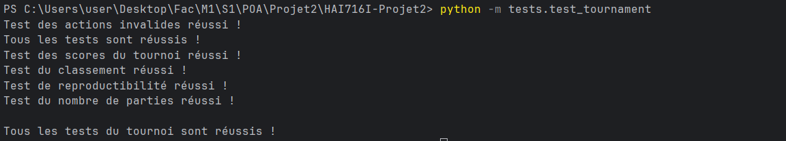
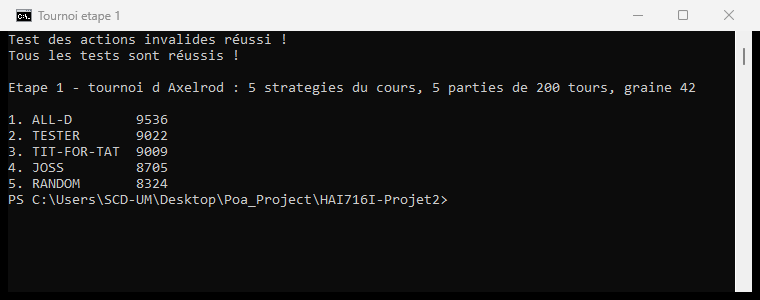
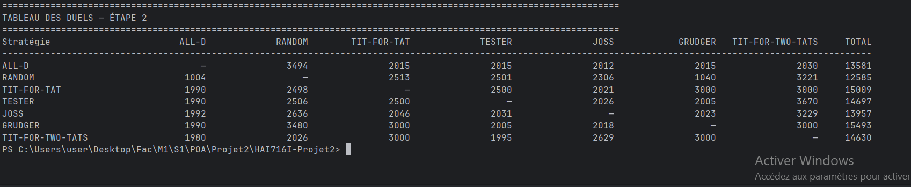

# Journal de bord — Projet 2 : Dilemme du prisonnier itéré

**Étudiant :** Skander SAAFI  
**UE :** HAI716I - Programmation Orientée Agents  
**Langage :** Python
**Période :** 13–15 novembre 2026

## Partie 1 - Présentation du projet
### 1.1. Introduction
Ce projet consiste à développer un tournoi de dilemme du prisonnier itéré, inspiré des travaux de Robert Axelrod, afin d'étudier les interactions entre différentes stratégies.

L'objectif est de comparer les cinq stratégies étudiées en cours, d'en introduire de nouvelles, puis d'observer comment des modifications du tournoi influencent leurs performances.

Une attention particulière sera portée aux conditions favorisant la coopération, aux réactions face aux défections et aux différences entre les résultats obtenus et ceux du tournoi historique d'Axelrod.

### 1.2. Protocole expérimental
Le tournoi repose sur le dilemme du prisonnier itéré. À chaque tour, deux joueurs choisissent simultanément de coopérer (C) ou de faire défection (D), sans connaître le choix courant de leur adversaire.

Les gains sont définis par la matrice suivante :

| | Adversaire C | Adversaire D |
|---|---|---|
| **Joueur C** | (3, 3) | (0, 5) |
| **Joueur D** | (5, 0) | (2, 2) |

Le protocole initial comprend :

- **Population :** ALL-D, RANDOM, TIT-FOR-TAT, TESTER et JOSS.
- **Durée :** 200 tours par partie.
- **Répétitions :** 5 parties par paire de stratégies.
- **Graine pseudo-aléatoire :** 42, incrémentée selon le numéro de la partie.
- **Classement :** cumul des points obtenus par chaque stratégie.

Ces paramètres reprennent le cadre du tournoi demandé. La graine fixe permet de reproduire les expériences, notamment lorsque les stratégies utilisent des décisions aléatoires.

Dans notre première implémentation, chaque paire de stratégies distinctes joue cinq parties, sans confrontation d'une stratégie contre elle-même. Nous évitons également de répéter les confrontations inversées. Ces deux choix sont distincts et peuvent influencer le classement final.

Les expériences suivantes conserveront ce protocole de référence, sauf pour les paramètres explicitement modifiés, afin de faciliter les comparaisons.

### 1.3. Organisation du travail

Le développement a été réparti sur deux branches Git pour travailler en parallèle :

- **Ma partie (`feature/engine`) :** développement du moteur du jeu, du tournoi et des tests automatiques.
- **Partie de mon binôme (`feature/strategies_base`) :** implémentation des stratégies.

Nous avons défini une interface commune `jouer(mes_coups, ses_coups, rng)` afin de faciliter l'intégration des deux parties.

Les modifications sont enregistrées par des commits Git pour conserver une trace du développement.

## Partie 2 — Développement et expérimentations

### 2.1. Étape 1 — Tournoi de base

#### 2.1.1. Hypothèses initiales
Avant d'analyser les résultats du tournoi initial, je m'attendais à ce que TIT-FOR-TAT obtienne un bon classement, notamment grâce à sa capacité à coopérer avec les stratégies coopératives tout en sanctionnant les défections. Son comportement simple et réciproque avait notamment permis d'obtenir de bons résultats dans les tournois historiques d'Axelrod.

Je pensais également que ALL-D serait performante face aux stratégies qui coopèrent fréquemment, puisqu'elle peut exploiter leur coopération. En revanche, face à des stratégies capables de riposter, ses gains risquaient d'être limités.

Concernant RANDOM, je m'attendais à des résultats irréguliers, car ses décisions ne tiennent pas compte du comportement de l'adversaire.

Enfin, je supposais que TESTER et JOSS pourraient profiter de certaines stratégies coopératives, mais que leurs défections risquaient également de provoquer des représailles et de réduire leurs scores à long terme.

Mon hypothèse principale était donc que TIT-FOR-TAT figurerait parmi les stratégies les mieux classées, sans nécessairement terminer première, puisque le résultat dépend aussi des adversaires présents et du protocole du tournoi.

#### 2.1.2. Implémentation
J'ai commencé par développer le moteur d'une partie, puis le système permettant d'organiser un tournoi entre plusieurs stratégies.

Trois choix techniques ont guidé mon implémentation :

- **Simultanéité des décisions :** chaque stratégie dispose de son propre historique et de celui de son adversaire. Les historiques sont mis à jour uniquement après les deux décisions, afin qu'aucun joueur ne puisse connaître le coup courant de l'autre.
- **Reproductibilité :** les décisions aléatoires reposent sur des générateurs initialisés avec des graines déterminées, permettant de relancer les expériences dans les mêmes conditions.
- **Extensibilité :** toutes les stratégies utilisent l'interface `jouer(mes_coups, ses_coups, rng)`, ce qui permet d'en ajouter sans modifier le fonctionnement général du moteur.

J'ai ensuite implémenté le tournoi tous contre tous. Chaque paire de stratégies distinctes joue cinq parties de 200 tours, et les scores sont cumulés pour établir un classement décroissant.

Cette séparation entre moteur, tournoi et stratégies facilite les tests et permettra d'introduire les modifications expérimentales sans reconstruire l'ensemble du programme.

Pour le tournoi initial, nous avons utilisé les cinq stratégies étudiées en cours. Le tableau suivant résume leurs règles, leurs origines et leurs comportements attendus face aux autres stratégies.

| Stratégie | Origine | Règle de fonctionnement | Forces et faiblesses attendues |
|---|---|---|---|
| **ALL-D** | Stratégie de référence étudiée en cours. | Joue toujours D, quel que soit le comportement adverse. | Exploite les stratégies coopératives, mais obtient des gains limités face aux adversaires qui ripostent systématiquement. |
| **RANDOM** | Stratégie aléatoire de référence étudiée en cours. | Choisit C ou D aléatoirement à chaque tour. | Imprévisible, mais incapable d'adapter ses décisions à l'historique adverse. |
| **TIT-FOR-TAT** | Stratégie présentée par Anatol Rapoport lors des tournois d'Axelrod. | Commence par C, puis reproduit le dernier coup de l'adversaire. | Favorise la coopération réciproque et sanctionne rapidement les défections, mais peut être entraînée dans des cycles de représailles. |
| **TESTER** | Stratégie étudiée en cours, issue des stratégies exploratoires du dilemme du prisonnier itéré. | Commence par tester l'adversaire avec une défection. Selon sa réaction, elle poursuit une exploitation périodique ou adopte un comportement de type TIT-FOR-TAT. | Peut exploiter les adversaires tolérants, mais risque de déclencher des représailles durables. |
| **JOSS** | Variante historique de TIT-FOR-TAT étudiée en cours. | Suit TIT-FOR-TAT, mais effectue occasionnellement une défection lorsque la coopération était prévue (probabilité de 10 % dans notre implémentation). | Peut obtenir un gain supplémentaire ponctuel, mais risque de perturber une coopération stable. |

Ces stratégies présentent des comportements différents : certaines privilégient systématiquement la défection, d'autres favorisent la réciprocité ou introduisent une part d'aléatoire. Cette diversité permet d'étudier l'influence de la composition du tournoi sur les performances individuelles.

#### 2.1.3. Tests et difficultés

Avant d'intégrer les cinq stratégies du cours, j'ai vérifié le moteur avec trois stratégies simples : ALL-C, ALL-D et TIT-FOR-TAT.

Les tests automatiques ont permis de contrôler :

- **La matrice des gains :** vérifier que les décisions C et D produisent les scores attendus.
- **Le cumul des scores :** vérifier que les points sont correctement additionnés sur plusieurs parties.
- **Le classement :** vérifier que les stratégies sont triées selon leur score total.
- **La répétabilité :** vérifier que deux exécutions du même scénario produisent des résultats identiques.

Tous les tests réalisés ont réussi.

**Capture d'écran des tests :**

Lors des premiers tests, j'ai rencontré un problème d'importation entre les modules du moteur et ceux du tournoi. J'ai vérifié l'organisation des fichiers et adapté la manière d'exécuter les tests pour que Python reconnaisse correctement les modules du projet.

Un second problème concernait les stratégies fictives utilisées pour les tests : elles ne possédaient pas l'attribut `nom`, pourtant nécessaire au dictionnaire des scores. J'ai ajouté cet attribut afin de rendre les stratégies de test compatibles avec le tournoi.

Ces difficultés ont permis de clarifier le contrat entre les stratégies et le moteur. Les tests réalisés avec des stratégies simples ont validé le fonctionnement de base avant l'intégration de stratégies plus complexes.

#### 2.1.4. Résultats et analyse
**a) Classement du tournoi initial**

Après l'intégration des cinq stratégies, nous avons exécuté le tournoi selon le protocole défini précédemment : cinq parties de 200 tours pour chaque paire de stratégies distinctes, sans auto-rencontres.

Le classement obtenu est le suivant :

| Rang | Stratégie | Score total |
|---|---|---|
| 1 | ALL-D | 9536 |
| 2 | TESTER | 9022 |
| 3 | TIT-FOR-TAT | 9009 |
| 4 | JOSS | 8705 |
| 5 | RANDOM | 8324 |

**Capture d'écran du classement initial :**

**b) Comparaison avec les hypothèses initiales**

Mon hypothèse initiale était que TIT-FOR-TAT figurerait parmi les stratégies les mieux classées grâce à sa capacité à maintenir une coopération réciproque.

Cependant, dans notre configuration sans auto-rencontres, ALL-D a obtenu le meilleur score total.

Ce résultat peut s'expliquer par la composition du tournoi : ALL-D profite des stratégies qui coopèrent suffisamment souvent, tandis que TIT-FOR-TAT peut perdre des points face aux adversaires qui provoquent des défections ou des cycles de représailles.

Le résultat ne signifie donc pas qu'ALL-D est systématiquement supérieure à TIT-FOR-TAT. Il montre plutôt que les performances d'une stratégie dépendent des adversaires rencontrés et des règles du tournoi.

**c) Influence des auto-rencontres**

Pour mieux comprendre ce résultat, nous avons comparé deux configurations :

- **Configuration A :** chaque stratégie affronte uniquement les autres stratégies.
- **Configuration B :** les confrontations d'une stratégie contre elle-même sont également autorisées.

Dans les conditions testées, nous avons observé que **ALL-D terminait première dans la configuration A**, tandis que **TIT-FOR-TAT retrouvait la première place dans la configuration B**.

| Rang | Stratégie | Score total |
|---|---|---:|
| 1 | TIT-FOR-TAT | 12 009 |
| 2 | TESTER | 11 687 |
| 3 | ALL-D | 11 536 |
| 4 | RANDOM | 10 810 |
| 5 | JOSS | 10 723 |

**Capture d'écran de la comparaison :**

L'ajout des auto-rencontres modifie le classement initial : TIT-FOR-TAT passe de la troisième à la première place, tandis qu'ALL-D descend de la première à la troisième.

Cette évolution s'explique notamment par les gains obtenus lors des confrontations d'une stratégie contre elle-même.

TIT-FOR-TAT coopère systématiquement avec une copie d'elle-même, ce qui lui rapporte 3 points par tour, soit 3 000 points sur cinq parties de 200 tours.

À l'inverse, ALL-D joue toujours D contre elle-même et obtient 2 points par tour, soit 2 000 points sur les cinq parties.

Ainsi, les auto-rencontres apportent 1 000 points supplémentaires à TIT-FOR-TAT par rapport à ALL-D, ce qui suffit à inverser leur position dans notre classement.

Cette expérience montre que le protocole du tournoi, et notamment l'inclusion ou non des auto-rencontres, peut influencer fortement les résultats.

**d) Comparaison avec les résultats d'Axelrod**

Dans les tournois historiques d'Axelrod, TIT-FOR-TAT s'est distinguée par ses bonnes performances, malgré sa règle très simple.

Dans notre tournoi initial sans auto-rencontres, elle ne termine pas première, contrairement au résultat historique souvent associé à cette stratégie.

Plusieurs différences peuvent expliquer cet écart : le nombre et la nature des stratégies participantes, l'absence d'auto-rencontres et les modalités de calcul des scores.

Notre comparaison montre ainsi qu'un classement ne constitue pas une propriété absolue d'une stratégie : il dépend du contexte expérimental.

**Conclusion de l'étape 1**

Cette première expérience m'a permis de vérifier le fonctionnement du moteur et de constater que les choix de protocole peuvent influencer fortement les résultats.

L'observation la plus importante est le changement de stratégie gagnante lorsque les auto-rencontres sont incluses. Elle souligne la nécessité de préciser les règles du tournoi avant de comparer les performances des stratégies.

### 2.2. Étape 2 - Ajout de nouvelles stratégies

#### 2.2.1. Hypothèses initiales

Avant d'exécuter le tournoi avec les deux nouvelles stratégies, j'ai formulé plusieurs hypothèses concernant leur comportement et leur influence sur le classement général.

L'objectif de cette deuxième expérience est d'étudier comment deux approches opposées face aux défections - la punition permanente et la tolérance - peuvent influencer les performances dans un dilemme du prisonnier itéré.

**a) Hypothèses concernant GRUDGER**

GRUDGER commence par coopérer et maintient cette coopération tant que son adversaire ne fait pas défection. Dès qu'une défection est observée, elle répond par une défection permanente, même si l'adversaire recommence à coopérer.

Je m'attends à ce que cette stratégie soit particulièrement performante face aux adversaires qui coopèrent systématiquement ou qui ne font jamais défection en premier, comme TIT-FOR-TAT. Dans ce cas, les deux stratégies peuvent maintenir une coopération mutuelle et obtenir chacune 3 points par tour.

En revanche, GRUDGER risque d'être moins performante face à RANDOM, JOSS ou TESTER. Une seule défection adverse suffit à provoquer une rupture définitive de la coopération, ce qui peut limiter les gains des deux joueurs pendant le reste de la partie.

Je suppose donc que GRUDGER obtiendra un classement relativement favorable face aux stratégies coopératives, mais que son absence de pardon constituera une faiblesse importante dans une population comportant des stratégies provocatrices ou aléatoires.

**b) Hypothèses concernant TIT-FOR-TWO-TATS**

TIT-FOR-TWO-TATS adopte un comportement plus tolérant. Elle commence par coopérer et ne fait défection que lorsque son adversaire a joué D lors des deux tours précédents.

Contrairement à TIT-FOR-TAT, qui réagit immédiatement à une défection, TIT-FOR-TWO-TATS accepte donc une défection isolée sans sanction.

Je m'attends à ce que cette tolérance favorise le maintien de la coopération face aux stratégies qui font occasionnellement défection, notamment JOSS. Elle pourrait ainsi éviter certains cycles de représailles et obtenir de meilleurs scores que TIT-FOR-TAT dans certaines confrontations.

Cependant, cette indulgence peut également être exploitée. Face à un adversaire qui alterne régulièrement coopération et défection sans jamais faire défection deux fois consécutivement, TIT-FOR-TWO-TATS risque de continuer à coopérer sans sanctionner ce comportement.

Face à ALL-D, elle devrait également subir une perte initiale avant de réagir, puisqu'elle attend deux défections consécutives avant de faire elle-même défection.

Je suppose donc que TIT-FOR-TWO-TATS sera particulièrement intéressante face aux défections occasionnelles, mais potentiellement vulnérable face aux stratégies capables d'exploiter sa tolérance.

**c) Hypothèses sur l'évolution du classement général**

L'ajout de GRUDGER et TIT-FOR-TWO-TATS modifie la composition du tournoi, qui passe de cinq à sept stratégies.

Je m'attends à ce que cette modification influence les scores et éventuellement le classement des cinq stratégies initiales, puisque chacune affrontera désormais deux adversaires supplémentaires.

GRUDGER pourrait favoriser les stratégies qui maintiennent une coopération stable, tandis que TIT-FOR-TWO-TATS pourrait offrir de nouvelles possibilités d'exploitation aux stratégies qui font défection occasionnellement.

Je ne suppose donc pas que le classement initial, dominé par ALL-D, restera nécessairement inchangé.

Mon hypothèse principale est que **la tolérance et la sévérité ne constituent pas des avantages absolus** : leur efficacité dépend du comportement des adversaires et de la fréquence des défections.

**d) Protocole de comparaison prévu**

Pour tester ces hypothèses, je conserverai les paramètres du tournoi initial :

- 200 tours par partie ;
- 5 parties par paire de stratégies ;
- graine pseudo-aléatoire initiale fixée à 42 ;
- absence d'auto-rencontres ;
- absence de répétition des confrontations inversées ;
- classement établi à partir du cumul des scores.

La seule modification sera l'ajout de GRUDGER et TIT-FOR-TWO-TATS aux cinq stratégies initiales.

Je comparerai ensuite le classement des sept stratégies avec celui du tournoi initial, en examinant particulièrement les performances de GRUDGER, TIT-FOR-TWO-TATS, TIT-FOR-TAT et ALL-D.

Cette comparaison permettra de déterminer si les observations confirment mes hypothèses et d'identifier les comportements favorisant ou limitant la coopération.

#### 2.2.2. Implémentation

Pour cette deuxième étape, nous avons ajouté deux nouvelles stratégies au tournoi initial : GRUDGER et TIT-FOR-TWO-TATS. Le tournoi passe ainsi de cinq à sept stratégies.

Notre choix permet de comparer deux comportements opposés face aux défections : une stratégie qui sanctionne définitivement la première trahison et une autre qui tolère les défections isolées.

**a) GRUDGER — Une stratégie sans pardon**

GRUDGER, implémentée par mon binôme, commence par coopérer et continue tant que son adversaire n'a jamais fait défection.

Dès qu'une défection adverse est observée, elle joue définitivement D, même si l'adversaire recommence à coopérer.

Son fonctionnement repose sur une vérification de l'historique adverse : si celui-ci contient au moins un D, la stratégie fait défection.

Cette implémentation ne nécessite aucune variable d'état supplémentaire, puisque l'historique conserve toutes les décisions précédentes.

**b) TIT-FOR-TWO-TATS — Une stratégie tolérante**

De mon côté, j'ai choisi d'implémenter TIT-FOR-TWO-TATS, une variante de TIT-FOR-TAT qui introduit davantage de tolérance.

Contrairement à TIT-FOR-TAT, qui reproduit immédiatement le dernier coup adverse, TIT-FOR-TWO-TATS ne fait défection que si l'adversaire a joué D lors des deux derniers tours consécutifs.

Son comportement repose sur trois règles :

1. Si l'adversaire a joué moins de deux coups, coopérer.
2. Si ses deux derniers coups sont D, faire défection.
3. Dans tous les autres cas, coopérer.

Cette stratégie ne conserve pas non plus d'état interne : elle utilise directement les deux derniers éléments de l'historique adverse.

L'objectif de cette implémentation est d'étudier si une tolérance supplémentaire peut préserver la coopération face aux défections occasionnelles, tout en observant les risques d'exploitation associés.

**c) Intégration des nouvelles stratégies**

Les deux stratégies respectent l'interface commune `jouer(mes_coups, ses_coups, rng)` utilisée par le moteur.

Leur intégration ne nécessite donc aucune modification du mécanisme de décision simultanée ni de la matrice des gains.

Le tournoi étendu comprend désormais :

- ALL-D ;
- RANDOM ;
- TIT-FOR-TAT ;
- TESTER ;
- JOSS ;
- GRUDGER ;
- TIT-FOR-TWO-TATS.

Nous avons conservé le protocole expérimental initial : cinq parties de 200 tours pour chaque paire de stratégies distinctes, avec une graine initiale fixée à 42 et sans auto-rencontres.

Cette continuité permet d'étudier l'effet de l'ajout des deux stratégies sans introduire simultanément d'autres modifications expérimentales.

**d) Outil d'analyse des confrontations individuelles**

Pour approfondir l'analyse, mon binôme a également ajouté une fonction `run_duels()`.

Contrairement à `run_tournament()`, qui calcule les scores cumulés et établit le classement général, cette fonction conserve les scores de chaque confrontation individuelle.

Elle retourne un dictionnaire dont les clés correspondent aux couples de noms de stratégies et dont les valeurs représentent les points obtenus par la première stratégie face à la seconde.

Les deux scores d'une confrontation entre stratégies distinctes sont enregistrés séparément, sans rejouer la partie dans l'ordre inverse.

Cette fonction nous permet d'identifier les adversaires favorables ou défavorables à chaque stratégie et d'expliquer les variations de classement à partir des résultats des duels.

Elle constitue donc un outil complémentaire pour l'analyse expérimentale de cette deuxième étape.

#### 2.2.3. Tests et difficultés

Avant d'interpréter les résultats du tournoi étendu, j'ai réalisé des tests automatiques afin de vérifier que les sept stratégies respectaient les règles de fonctionnement attendues.

**a) Vérification des stratégies déterministes**

Pour ALL-D, j'ai vérifié qu'elle faisait systématiquement défection, indépendamment de l'historique adverse.

Pour TIT-FOR-TAT, les tests ont confirmé qu'elle coopérait au premier tour, puis reproduisait le dernier coup de son adversaire.

Pour GRUDGER, j'ai vérifié qu'elle coopérait en l'absence de défection adverse et qu'une seule défection passée suffisait à provoquer une défection permanente.

Pour TIT-FOR-TWO-TATS, j'ai testé plusieurs situations représentatives :

| Historique adverse | Décision attendue | Justification |
|---|---|---|
| Aucun coup | C | Coopération initiale |
| D | C | Une seule défection est tolérée |
| C, D | C | Défection isolée |
| D, D | D | Deux défections consécutives |
| D, C | C | Retour à la coopération |
| D, D, D | D | Défections consécutives persistantes |

Ces tests permettent notamment de vérifier les conditions initiales, les réactions aux défections et le retour à la coopération.

**b) Vérification des stratégies aléatoires**

Pour RANDOM, j'ai utilisé un générateur aléatoire contrôlé afin de vérifier que la stratégie coopérait lorsque la valeur générée était inférieure à 0,5 et faisait défection dans le cas contraire.

J'ai également comparé deux séquences produites avec la même graine pour vérifier leur reproductibilité.

Pour JOSS, j'ai testé les décisions aux limites de sa probabilité de défection de 10 %, ainsi que sa réaction à une défection adverse.

Ces vérifications permettent de contrôler les règles probabilistes sans dépendre de tirages imprévisibles pendant les tests.

**c) Vérification de TESTER**

J'ai également testé le comportement de TESTER dans plusieurs situations, notamment son premier coup D, son cycle de décisions face à un adversaire coopératif et le passage à son mode de riposte.

Ces tests vérifient le comportement de l'implémentation actuelle. L'interprétation exacte de la riposte reste toutefois un choix de modélisation important, susceptible d'influencer les résultats expérimentaux.

**d) Difficulté rencontrée et correction**

Lors de la première exécution des tests de TIT-FOR-TWO-TATS, une assertion a échoué dès le premier tour.

La stratégie retournait D alors que son comportement attendu était de commencer par C.

Après vérification, j'ai identifié une erreur dans la condition traitant les historiques adverses contenant moins de deux coups : j'avais écrit `return D` au lieu de `return C`.

J'ai corrigé cette instruction, puis relancé les tests. Toutes les stratégies ont ensuite passé les vérifications prévues.

Cette difficulté a montré l'importance de tester les cas limites, notamment les premiers tours, avant d'exécuter un tournoi complet.

**e) Résultat des tests**

Les tests réalisés sur les sept stratégies ont réussi après correction.

Ils permettent de vérifier les règles de décision dans les situations étudiées, sans constituer une preuve exhaustive de l'absence de défauts.

**Capture d'écran des tests des sept stratégies :**

#### 2.2.4. Résultats et analyse

**a) Classement du tournoi à sept stratégies**

Après l'intégration de GRUDGER et TIT-FOR-TWO-TATS, nous avons relancé le tournoi avec les sept stratégies, en conservant les paramètres de l'expérience initiale :

- 5 parties par paire de stratégies ;
- 200 tours par partie ;
- graine initiale fixée à 42 ;
- aucune auto-rencontre.

Le classement obtenu est le suivant :

| Rang | Stratégie | Score total |
|---|---|---:|
| 1 | GRUDGER | 15 493 |
| 2 | TIT-FOR-TAT | 15 009 |
| 3 | TESTER | 14 697 |
| 4 | TIT-FOR-TWO-TATS | 14 630 |
| 5 | JOSS | 13 957 |
| 6 | ALL-D | 13 581 |
| 7 | RANDOM | 12 585 |

**Capture d'écran du classement :**

Le premier résultat marquant est la victoire de GRUDGER, qui termine devant TIT-FOR-TAT avec 484 points d'avance.

L'ajout des deux nouvelles stratégies modifie également le classement des stratégies initiales : ALL-D passe de la première à la sixième place, tandis que TIT-FOR-TAT passe de la troisième à la deuxième.

Ce changement montre que la performance d'une stratégie dépend non seulement de ses propres règles, mais aussi des comportements des autres stratégies présentes dans le tournoi.

**b) Analyse des confrontations individuelles avec `run_duels()`**

Pour comprendre les résultats, nous avons utilisé la fonction `run_duels()`, développée par mon binôme.

Contrairement à `run_tournament()`, qui retourne les scores cumulés, cette fonction conserve les scores obtenus contre chaque adversaire.

Elle utilise le même ordre des stratégies, les mêmes graines aléatoires et les mêmes paramètres que le tournoi général.

Cette précaution est particulièrement importante pour RANDOM et JOSS : comme le moteur attribue un générateur aléatoire distinct à chaque joueur, inverser l'ordre des stratégies peut modifier leurs décisions et donc les résultats.

**Capture d'écran des confrontations individuelles :**

Nous avons également vérifié que, pour chaque stratégie, la somme des scores individuels retournés par `run_duels()` correspond au score total calculé par `run_tournament()`.

Cette vérification a été effectuée avec et sans auto-rencontres.

Elle permet de contrôler la cohérence entre les résultats détaillés et le classement général, sans pour autant démontrer que toutes les règles des stratégies sont exemptes d'erreurs.

**c) Pourquoi GRUDGER termine-t-elle première ?**

GRUDGER obtient 15 493 points, soit le meilleur score du tournoi.

Ses résultats individuels permettent de comprendre cette performance :

| Adversaire | Score de GRUDGER |
|---|---:|
| ALL-D | 1 990 |
| RANDOM | 3480 |
| TIT-FOR-TAT | 3 000 |
| TESTER | 2 005 |
| JOSS | 2 018 |
| TIT-FOR-TWO-TATS | 3 000 |
| **Total** | **15 493** |

Face à TIT-FOR-TAT et TIT-FOR-TWO-TATS, GRUDGER coopère pendant les 200 tours. Aucun joueur ne déclenche de défection, ce qui produit un gain de 3 points par tour, soit 3 000 points sur les cinq parties.

Face à ALL-D, GRUDGER coopère au premier tour et perd 0 contre 5. Dès le deuxième tour, elle fait définitivement défection. Elle obtient donc 199 × 2 = 398 points par partie, soit 1 990 points au total.

Face à RANDOM, GRUDGER obtient 3 480 points. Après la première défection de RANDOM, elle adopte un comportement permanent de défection et profite des coopérations occasionnelles de son adversaire.

En revanche, face à TESTER et JOSS, une défection suffit à interrompre définitivement la coopération. GRUDGER ne pardonne jamais, même lorsque son adversaire recommence à jouer C.

Ces résultats confirment en grande partie mes hypothèses : GRUDGER est particulièrement efficace contre les stratégies coopératives, mais son absence de pardon peut limiter ses gains face à des adversaires qui provoquent des défections.

Sa première place montre que, dans cette population précise et sans erreurs d'exécution, la punition permanente peut être avantageuse.

**d) Analyse de TIT-FOR-TWO-TATS : les limites de la tolérance**

La stratégie que j'ai implémentée, TIT-FOR-TWO-TATS, termine quatrième avec 14 630 points.

Elle commence par coopérer et ne fait défection que lorsque son adversaire a joué D deux fois consécutivement.

Cette règle lui permet de maintenir la coopération avec GRUDGER et TIT-FOR-TAT, puisqu'aucune de ces stratégies ne déclenche spontanément une défection dans ces confrontations.

Cependant, les résultats révèlent une faiblesse importante face à TESTER.

TESTER obtient 3 670 points contre TIT-FOR-TWO-TATS.

Lorsque TESTER n'observe aucune riposte, elle répète un comportement comprenant une défection tous les trois tours : D, C, C, D, C, C, ...

Or, TIT-FOR-TWO-TATS ne réagit qu'à deux défections consécutives. Comme TESTER ne joue jamais deux D de suite dans ce cycle, TIT-FOR-TWO-TATS continue à coopérer.

TESTER profite alors régulièrement de cette coopération pour obtenir 5 points lorsqu'elle joue D, tandis que TIT-FOR-TWO-TATS obtient 0 point sur ces tours.

Cette confrontation illustre un compromis fondamental : une stratégie tolérante évite certaines représailles inutiles, mais peut être exploitée par un adversaire qui fait défection régulièrement sans jamais dépasser son seuil de tolérance.

Ainsi, ma stratégie fonctionne bien face à des adversaires coopératifs, mais sa règle de punition est insuffisante contre certains comportements opportunistes.

**e) Comparaison avec le tournoi initial**

Dans le tournoi à cinq stratégies, ALL-D terminait première avec 9 536 points, tandis que TIT-FOR-TAT était troisième avec 9 009 points.

Après l'ajout de GRUDGER et TIT-FOR-TWO-TATS, TIT-FOR-TAT remonte à la deuxième place, alors qu'ALL-D descend à la sixième.

L'explication principale vient des nouvelles interactions possibles.

TIT-FOR-TAT dispose désormais de deux partenaires avec lesquels elle peut maintenir une coopération stable. Contre chacune de ces stratégies, elle peut obtenir 3 000 points.

ALL-D, au contraire, ne peut exploiter GRUDGER et TIT-FOR-TWO-TATS que temporairement : toutes deux finissent par sanctionner ses défections.

ALL-D conserve toutefois la possibilité d'exploiter RANDOM. Sa baisse de classement ne signifie donc pas qu'elle a perdu tous ses adversaires favorables.

Il faut également éviter de comparer directement les scores bruts des deux tournois : avec sept stratégies, chacune affronte six adversaires au lieu de quatre.

Une comparaison plus pertinente repose sur les rangs, les confrontations individuelles et, si nécessaire, les scores moyens par adversaire.

**f) Confrontation avec mes hypothèses initiales**

Avant l'expérience, j'avais formulé plusieurs hypothèses.

**Hypothèse 1 — GRUDGER sera performante contre les stratégies coopératives.**

Cette hypothèse est confirmée. GRUDGER obtient 3 000 points contre TIT-FOR-TAT et TIT-FOR-TWO-TATS grâce à une coopération ininterrompue.

**Hypothèse 2 — GRUDGER sera pénalisée par les stratégies qui provoquent des défections.**

Cette hypothèse est partiellement confirmée. TESTER et JOSS interrompent sa coopération, mais les pertes correspondantes ne suffisent pas à l'empêcher de remporter le tournoi.

**Hypothèse 3 — TIT-FOR-TWO-TATS pourra mieux tolérer les défections isolées.**

Cette propriété est bien présente dans son comportement. Cependant, le tournoi montre que cette tolérance peut devenir une faiblesse, notamment face à TESTER, qui exploite systématiquement son absence de réaction.

**Hypothèse 4 — L'ajout de stratégies coopératives modifiera le classement initial.**

Cette hypothèse est confirmée. TIT-FOR-TAT progresse dans le classement, tandis qu'ALL-D recule fortement.

Ces observations montrent l'intérêt de formuler les hypothèses avant l'expérience : elles permettent de distinguer les résultats attendus des comportements réellement surprenants.

**g) Limites de l'expérience**

Même si GRUDGER termine première, ce résultat ne signifie pas qu'elle est universellement supérieure aux autres stratégies.

Premièrement, le tournoi ne contient que sept stratégies. Une population différente pourrait modifier le classement.

Deuxièmement, les décisions sont exécutées sans erreur. Dans ces conditions, deux stratégies coopératives peuvent maintenir leur coopération pendant toute la partie.

Troisièmement, la durée de chaque partie est fixée à 200 tours. Le classement pourrait évoluer avec d'autres durées ou d'autres règles d'arrêt.

Enfin, les stratégies probabilistes dépendent des tirages aléatoires. La graine fixe rend l'expérience reproductible, mais elle ne suffit pas à démontrer que les résultats seraient identiques avec d'autres graines.

Ces limites invitent à étudier la robustesse des stratégies plutôt qu'à considérer le classement obtenu comme une conclusion définitive.

**h) Conclusion de l'étape 2**

Cette deuxième étape met en évidence l'influence de la composition du tournoi sur les performances des stratégies.

GRUDGER remporte le tournoi grâce à sa capacité à maintenir la coopération avec les stratégies coopératives tout en sanctionnant définitivement les défections.

TIT-FOR-TWO-TATS montre qu'une plus grande tolérance peut préserver la coopération, mais aussi permettre une exploitation répétée par des stratégies opportunistes comme TESTER.

Le résultat le plus important est donc qu'aucune règle de comportement ne garantit à elle seule la victoire : les performances dépendent des interactions entre les stratégies et des conditions expérimentales.

Une question reste alors ouverte : **que se passerait-il si une coopération pouvait être transformée accidentellement en défection ?**

Dans ce cas, GRUDGER pourrait sanctionner définitivement une simple erreur, tandis que TIT-FOR-TWO-TATS pourrait bénéficier de sa tolérance.

Cette question constitue une motivation directe pour l'étape 3, dans laquelle nous étudierons l'influence de modifications du protocole expérimental.

### 2.3. Étape 3 - Modifications du tournoi

#### 2.3.1. Hypothèses initiales

Pour cette troisième étape, nous avons décidé de modifier deux paramètres du tournoi afin d'étudier la robustesse des stratégies dans des conditions différentes de celles du protocole initial.

Les deux modifications choisies sont :

- L'introduction d'un bruit de 5 % sur les actions exécutées.
- Le remplacement de la durée fixe de 200 tours par un horizon inconnu, avec une probabilité de continuation de 0,995 après chaque tour.

Ces modifications seront étudiées séparément afin de pouvoir identifier leur influence respective sur les résultats.

Voici mes prédictions pour les deux nouvelles modifications potentielles :

**a) Première modification : introduction d'un bruit de 5 %**

Dans le tournoi initial, les actions choisies par les stratégies sont toujours exécutées correctement.

Nous souhaitons maintenant introduire une probabilité de 5 % qu'une action soit inversée lors de son exécution : une coopération C peut devenir une défection D, et inversement.

Cette modification permet de simuler des erreurs de communication ou d'exécution.

Je suppose que ce bruit perturbera particulièrement les stratégies qui réagissent fortement aux défections.

GRUDGER, qui a remporté le tournoi précédent, risque de perdre son avantage. En effet, une seule défection accidentelle suffit à déclencher une punition permanente, même contre un adversaire qui souhaitait coopérer.

TIT-FOR-TAT pourrait également rencontrer des difficultés. Une défection accidentelle peut provoquer des représailles réciproques, entraînant une alternance durable entre coopération et défection.

À l'inverse, TIT-FOR-TWO-TATS pourrait mieux résister aux erreurs isolées, puisqu'elle ne sanctionne que deux défections consécutives.

**Mon hypothèse principale est donc que TIT-FOR-TWO-TATS progressera dans le classement, tandis que GRUDGER reculera.**

Je ne suppose cependant pas que TIT-FOR-TWO-TATS terminera nécessairement première : sa tolérance peut toujours être exploitée par des stratégies comme TESTER.

**b) Deuxième modification : horizon inconnu**

Dans les expériences précédentes, chaque partie durait exactement 200 tours.

Nous souhaitons maintenant introduire un horizon inconnu : après chaque tour, la partie continue avec une probabilité `w = 0,995` et s'arrête avec une probabilité de 0,005.

La durée devient donc aléatoire. Avec cette valeur de `w`, le nombre moyen de tours est de 200, ce qui permet de conserver une durée moyenne comparable à celle du tournoi initial.

Cette modification est intéressante car elle supprime la connaissance du dernier tour.

Dans un dilemme du prisonnier répété avec une durée connue, la défection peut être justifiée par un raisonnement à rebours : au dernier tour, il n'existe plus de possibilité de représailles futures.

Avec un horizon inconnu, ce raisonnement ne s'applique plus de la même manière, car les joueurs ne savent pas quand la partie se terminera.

Je suppose néanmoins que cette modification pourrait avantager ALL-D dans certaines confrontations courtes. En effet, ALL-D exploite immédiatement les stratégies qui commencent par coopérer, alors que celles-ci ont besoin de plusieurs tours pour réagir.

Cependant, les parties longues pourraient continuer à favoriser les stratégies capables de maintenir une coopération stable, comme TIT-FOR-TAT et GRUDGER.

**Mon hypothèse principale est donc que l'horizon inconnu modifiera les écarts de scores et pourrait améliorer le classement d'ALL-D, sans garantir qu'elle remporte le tournoi.**

#### 2.3.2. Implémentation

#### 2.3.3. Tests et difficultés

#### 2.3.4. Résultats et analyse

## Partie 3 — Bilan final

### 3.1. Synthèse des résultats

### 3.2. Limites et améliorations possibles
